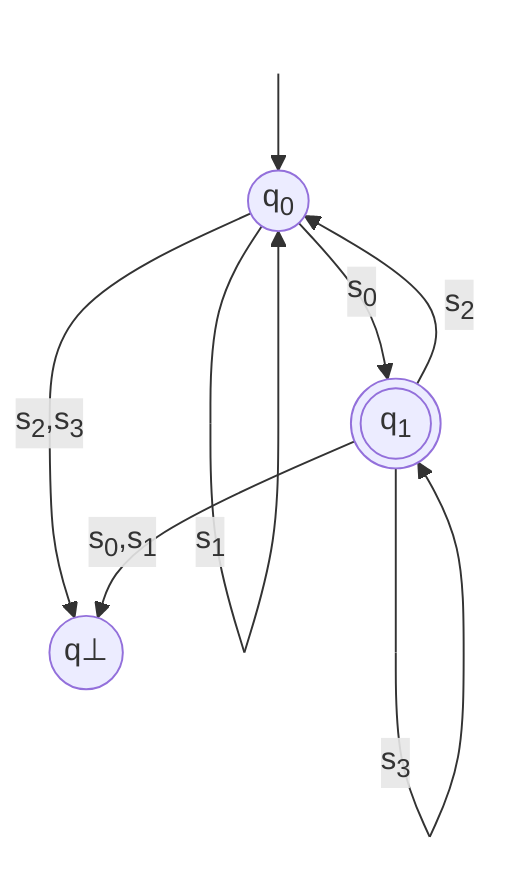
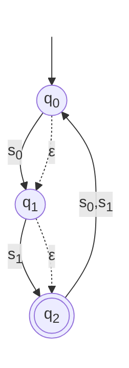

# PyLGEN — Formal Foundations


<!-- source: docs/formal-foundations/formal-foundations-intro.md -->

# Formal Foundations

PyLGEN is a practical framework, but it doesn't hide its mathematics. Every module (the lexer, the regex engine, the parser) is a direct implementation of a well-known formal model. Understanding those models makes the framework predictable, debuggable, and extensible. It also lets you reason about why a grammar works, why a lexer is fast, and why a parser rejects an input.

This section collects the theory behind the framework. It's not a replacement for a compiler course, and it doesn't cover everything. It covers the parts you'll actually encounter when using PyLGEN:

 - **Automata theory**: the DFA and the hybrid ε-DFA, the two models that power the lexer.

 - **Regular languages**: Kleene's theorem, the equivalence between regex, automata, and regular grammars.

 - **Context-free grammars**: the formalism behind every parser in PyLGEN.

 - **LR parsing**: LR(0), SLR, LR(1), and LALR(1), the algorithms that build the parsing tables.

 - **Tokenization theory**: maximal munch, and why the lexer uses a single combined DFA.

You don't need to read this section to use PyLGEN. But if you've ever wondered what `Lexer.initialize()` does or why `ParserBuilder.build_parser_from_attributed` can fail with a conflict, this is where the answers live.

## How to read this section

Each page is self-contained, but they build on each other:

| **Page** | **Prerequisites** | **What it covers** |
| :---: | :---: | :---: |
| [**Automata**](./formal-foundations-automata.md) | `None`	| DFA, hybrid ε-DFA, acceptance, regular languages |
| [**Context-Free Grammars**](./formal-foundations-context-free-grammars.md) | `None` | CFG definition, derivations, language of a grammar |
| [**Regular Languages**](./formal-foundations-regular-languages.md) | **Automata** and **Context-Free Grammars** | Kleene algebra, Kleene's theorem, regex ↔ automaton |
| [**LR Parsing**](./formal-foundations-lr-parsing.md) | **CFG** | LR items, SLR, LR(1), LALR(1), lookahead propagation |
| [**Tokenization**](./formal-foundations-tokenization.md) | **Automata** | Maximal munch, combined DFA, linear-time scanning |


<!-- source: docs/formal-foundations/formal-foundations-regular-languages.md -->

# Regular Expressions and Kleene's Theorem

[Regular expressions](https://en.wikipedia.org/wiki/Regular_expression) are the ***lingua franca*** of pattern matching. They provide a concise, declarative way to describe sets of strings, and they are the foundation upon which lexical analyzers are built. This page covers the formal model behind PyLGEN's regex engine.

## Kleene Algebra

At its core, the regex module implements the [**Kleene algebra**](https://en.wikipedia.org/wiki/Kleene_algebra) of regular expressions. A regular expression over an alphabet $\Sigma$ is defined inductively:

 - **Empty Language**: $\varnothing$ (matches nothing).
 - **Empty String**: $\epsilon$ (matches the empty string).
 - **Single Symbol**: $a$ for $a \in \Sigma$ (matches the symbol $a$).
 - **Union**: $R$ $|$ $S$ (matches either $R$ or $S$).
 - **Concatenation**: $RS$ (matches $R$ followed by $S$).
 - **Kleene Star**: $R^*$ (matches zero or more repetitions of $R$).

> ### Kleene's Theorem

By **Kleene's theorem**, every regular expression has an equivalent finite automaton (DFA or NFA), and every finite automaton corresponds to a regular expression. The three formalisms (regular expressions, finite automata, and regular grammars), are all equivalent in expressive power.

PyLGEN implements constructive proofs of this theorem:

 - **Regex → Automaton**: builds an NFA using a construction method equivalent to the **standard Thompson construction** (with $\epsilon$‑transitions), then determinizes and minimizes it.

 - **Automaton → Regex**: The module implements the **state elimination algorithm** (also known as the [**Brzozowski‑McCluskey method** or **Arden's lemma**](https://en.wikipedia.org/wiki/Arden%27s_rule)) to derive a regular expression from a DFA.

## Regular Grammars

A grammar is **regular** if all productions have one of the following forms:

 - **Right-linear**: $A \rightarrow a$ or $A \rightarrow aB$.
 - **Left-linear**: $A \rightarrow a$ or $A \rightarrow Ba$.

By converting such grammars to automata and vice versa, the module provides a complete translation between the three formalisms: regex, automata, and regular grammars.

## The Three-Way Equivalence

| **Formalism** | **Recognizes** | **Conversion** |
| :---: | :---: | :---: |
| **Regular Expression** | **Regular languages** | **↔ Automaton, ↔ Grammar** |
| **Finite Automaton (DFA/NFA/hybrid)** | **Regular languages** | **↔ Regex, ↔ Grammar** |
| **Regular Grammar** | **Regular languages** | **↔ Automaton, ↔ Regex** |

All three are computationally equivalent. The choice of which to use depends on the task:

 - Regex is concise and human-readable, ideal for specifying token patterns.

 - Automata are executable and efficient, ideal for scanning.

 - Regular grammars integrate with the rest of the grammar-based tooling.


<!-- source: docs/formal-foundations/formal-foundations-automata.md -->

# Automata Theory

This page covers the mathematical foundations of finite automata: the formal definition of a DFA, its tabular and graphical representations, the extended transition function, acceptance conditions, and the hybrid ε-DFA model. These are the theoretical basis for lexical analysis in PyLGEN.

## Definition

Formally, a [**deterministic finite automata (DFA)**](https://en.wikipedia.org/wiki/Deterministic_finite_automaton) is a **5-tuple $(Q,\Sigma,\delta,q_0,F)$** where:

 - **$Q$** is a **finite set of states**.
 - **$\Sigma$** is a **finite set of symbols** called **alphabet**.
 - **$\delta:Q \times \Sigma \rightarrow Q$** the **total transition function** that maps a tuple ***(state,symbol)*** to an state.
 - **$q_0 \in Q$** the initial state of the automata.
 - **$F \subseteq Q$** the set of ***accepting* states** called **final states**.

## Tabular Representation (Transition Table)

The transition function $\delta$ can be conveniently represented as a state-transition table. Rows correspond to states, columns to alphabet symbols, and each cell contains the resulting target state.

> **IMPORTANTE**
Since a DFA requires a total function, every cell in the table must be filled. If a transition is not explicitly defined for a given *(state, symbol)*, we introduce an **implicit *dead* state** (often denoted $\varnothing$ or $q\bot$) that is not in $F$ and loops back to itself on all symbols.

> ### Example

Let’s define a DFA *A* where:

 - $Q = \lbrace q_0, q_1, q\bot\rbrace$.

 - $\Sigma = \lbrace s_0, s_1, s_2, s_3\rbrace$.

 - $q_0$ is the start state.

 - $F = \lbrace q_1 \rbrace$ (only $q_1$ is accepting).

 - $\delta$ is given as:
    - $\delta(q_0, s_0) = q_1, \delta(q_0, s_1) = q_0$,
    - $\delta(q_1, s_2) = q_0, \delta(q_1, s_3) = q_1$,
    - and all remaining transitions go to the dead state $q\bot$.

The transition table is:

| **State** | **$s_0$** | **$s_1$** | **$s_2$** | **$s_3$** |
| :---: | :---: | :---: | :---: | :---: |
| **$\rightarrow q_0$** | $q_1$ | $q_0$ | $q\bot$ | $q\bot$ |
| **$*q_1$** | $q\bot$ | $q\bot$ | $q_0$ | $q_1$ |
| **$q\bot$** | $q\bot$ | $q\bot$ | $q\bot$ | $q\bot$ |

#### **Legend**

 - $ \rightarrow $ : denotes the **initial state**.
 - $*$ (or double circle in diagrams) : denotes an **accepting state**.
 - $q\bot$ : is the **dead**(non-accepting) state.

## Extended Transition Function ($\hat{\delta}$)

To define acceptance of strings (not just single symbols), we extend $\delta$ to operate on $\Sigma^*$ (the set of all finite strings over $\Sigma$). We define the **extended transition function**:

$$
\hat{\delta} : Q \times \Sigma^* \rightarrow Q
$$

recursively as follows:

 - **Base case (empty string $\epsilon$)**:

$$
\hat{\delta}\lparen q, \epsilon\rparen = q
$$

*Interpretation*: Without consuming any input, the automaton stays in its current state.

 - **Recursive step (string $w = xa$), where $x \in \Sigma^*$ and $a \in \Sigma$**

$$
\hat{\delta}\lparen q,xa) = \delta\lparen\hat{\delta}\lparen q,x \rparen , a \rparen
$$

*Interpretation*: To process $xa$, first process the prefix $x$ (reaching an intermediate state), then apply the normal transition $\delta$ with the final symbol $a$.

Since $\delta$ is total, $\hat{\delta}$ is also total: **every** possible input string leads to exactly one well-defined state.

## Acceptance Condition (Language of the DFA)

A string $w \in \Sigma^*$ is **accepted** by the DFA $A$ if, starting from the initial state $q_0$ and processing the entire string, the automaton ends in a state that belongs to the set of finals states $F$.

Formally, the **language recognized**(or accepted) by $A$ is:

$$
L\lparen A \rparen = \lbrace w \in \Sigma^* : \hat{\delta} \lparen q_0,w \rparen \in F \rbrace
$$

A string is **rejected** if the final state is not in $F$. Thanks to the explict dead state $q\bot$, any string that encounters an undefined transition ends up in $q\bot$, guaranteeing rejection.

> ### Acceptance Examples (Using DFA $A$)

Let's us test a few string over $\Sigma = \lbrace s_0,s_1,s_2,s_3 \rbrace$:

| **String $w$** | **Computation ($\hat{\delta}\lparen q_0,w\rparen$)** | **Final State** | **In $F$?** | **Veredict** |
| :---: | :---: | :---: | :---: | :---: |
| **$s_0s_3$** | $\delta\lparen q_0,s_0\rparen = q_1$, then $\delta\lparen q_1,s_3 \rparen = q_1$ | $q_1$ | Yes | Accepted ✅ |
| **$s_0s_2$** | $\delta\lparen q_0,s_0\rparen = q_1$, then $\delta\lparen q_1,s_2 \rparen = q_0$ | $q_0$ | No | Rejected ❌ |
| **$s_0s_1$** | $\delta\lparen q_0,s_0\rparen = q_1$, then $\delta\lparen q_1,s_1 \rparen = q\bot$ | $q\bot$ | No | Rejected ❌ |

Notice that the DFA does not *"know"* whether it will accept until it has **consumed the entire input string**. Acceptance depends solely on the state where the computation halts.

## Graphical Representation (State Transition Diagram)

In addition to the formal tuple and the transition table, a DFA is often visualized using a **state transition diagram**, a **directed labeled graph**. This representation is invaluable for human understanding, design, and debugging.

> ### Conventions for drawing a DFA

| **Component** | **Graphical convention** |
| :---: | :---: |
| **States ($Q$)** | Circles (or nodes). |
| **Initial state ($q_0$)** | An incoming arrow with no origin (pointing to the circle). |
| **Accepting states ($F$)** | Double circles (concentric circles). |
| **Transitions ($\delta$)** | Directed edges (arrows) from state $p$ to state $q$, labeled with the symbol $a \in \Sigma$ for which $\delta\lparen p,a \rparen = q$ |

> **TIP: Crucial visual property of a DFA**
From **every state**, and for **each symbol** in $\Sigma$, there must be **exactly one outgoing edge** with that label. This visually enforces the totality of $\delta$.

> ### Graphical representation of DFA $A$



> **TIP: Interpreting paths**
- A string is accepted if following its symbols as edge labels from $q_0$ ends at a **double-circle** node.
- Any path ending at $q\bot$ (or  any single-circle node $q \notin F$), means rejection.

> ### On Omitting the Dead State

In many introductory textbooks or informal diagrams, the dead state $q\bot$ is omitted to reduce visual clutter. In such cases, missing outgoing edges are implicitly understood as "rejection traps." However, for formal rigor, especially when emphasizing the totality of $\delta$, it is highly recommended to include $q\bot$ explicitly in the diagram. This makes it clear that the automaton never gets stuck and always produces a definitive outcome.

> ### Equivalence of Representations

The three representations are fully interchangeable and mathematically equivalent. Each serves a distinct purpose:

| **Rpresentation** | **Formality Level** | **Best Used For** |
| :---: | :---: | :---: |
| **Tuple $\lparen Q,\Sigma,\delta,q_0,F\rparen$** | Most formal and precise. | Theoretical proofs, formal language definitions, and algorithmic specifications. |
| **Transition Table** | Concise and structured. | Implementation (e.g., matrix representation in code) and quick lookup. |
| **State Diagram (Graph)** | Intuitive and visual. | Human comprehension, system design, debugging, and educational explanation. |

## The Hybrid $\epsilon$-DFA (A Deterministic Core with Spontaneous Moves)

To simplify the construction of complex languages (union, concatenation, star) while keeping symbol consumption fully deterministic, we introduce an elegant intermediate model: **the hybrid $\epsilon$-DFA**.

We define the hybrid $\epsilon$-DFA as a 6-tuple:

$$
A = \lparen Q,\Sigma,\delta,\epsilon,q_0,F \rparen
$$

Where every $\epsilon \subseteq Q \times Q$ is an **epsilon relation** (a set of spontaneous moves), the rest of the components has the same definition from DFA.

> **NOTE: Key insight**
Nondeterminism is not in reading symbols (that remains deterministic) but purely in the ability to take $\epsilon$-moves at any time. This separation makes the model mathematically tidy and exceptionally convenient for language operations.

> ### Tabular Representation

The transition table now has a **separate column** for $\epsilon$‑destinations.

| **State** | **$s_0$** | **$s_1$** | **$\epsilon$-destination** |
| :---: | :---: | :---: | :---: |
| **$\rightarrow q_0$** | $q_1$ |  $q_0$ | $\lbrace q_2 \rbrace$ |
| **$q_1$** | $q\bot$ | $q_1$ | $\varnothing$ |
| **$*q_2$** | $q_2$ | $q\bot$ | $\lbrace q_0 \rbrace$ |

Every cell under alphabet symbols contains a single state (deterministic), while the $\epsilon$‑cell contains a set of states (possibly empty).

> ### Extended Transition Function and $\epsilon$‑Closure

Because $\epsilon$‑moves can be taken spontaneously before, between, and after reading symbols, we must define the $\epsilon$‑closure with respect to the relation $\epsilon$.

For any set of states $S \subseteq Q$:

 - **Base case**: $S \subseteq \epsilon-Closure \lparen S \rparen$.
 - **Inductive**: If $p \in \epsilon-Closure \lparen S \rparen$ and $\lparen p,r \rparen \in \epsilon$, then $r \in \epsilon-Closure \lparen S \rparen$.

The extended transition function $\hat{\delta}:Q \times \Sigma^* \rightarrow 2^Q$ is defined as:

 - **Base case**(empty string):

$$
\hat{\delta}\lparen q,\epsilon \rparen = \epsilon-Closure \lparen\lbrace q \rbrace\rparen
$$

 - **Recursive step**(string $w = xa$, with $x \in \Sigma^*$, $a \in \Sigma $): Let $S = \hat{\delta}\lparen q,x \rparen$. Since $\delta$ is deterministic, we define:

$$
move\lparen S, a \rparen = \lbrace \delta \lparen p, a\rparen : p \in S \rbrace
$$

Then:

$$
\hat{\delta}\lparen q,xa \rparen = \epsilon-Closure \lparen move \lparen S, a \rparen \rparen
$$

Notice how $\delta$ is applied pointwise to the set $S$, because it is deterministic, the result is still a set of states, but each element comes from a unique source.

> ### Acceptance Condition

A string $w \in \Sigma^*$ is accepted if, after processing all symbols (with $\epsilon$‑closures applied before and after each step), there exists at least one possible resulting state that is final:

$$
L\lparen A \rparen = \lbrace w \in \Sigma^* : \hat{\delta}\lparen q_0,w \rparen \cap F \neq \varnothing \rbrace
$$

This existential condition is the hallmark of the nondeterminism introduced solely by $\epsilon$‑moves.

> ### Graphical Representation

The diagram for a hybrid $\epsilon$‑DFA uses two distinct edge styles:

 - **Solid edges for alphabet symbols**. From each state, there is exactly one solid outgoing edge per symbol (deterministic).
 - **Dashed (or dotted) edges** labelled $\epsilon$ for spontaneous moves. Multiple $epsilon$‑edges may emanate from a single state, creating nondeterministic branching.



The tracing of an input string involves:

 - `1`: Taking any number of dashed $\epsilon$‑edges ($\epsilon$-Closure) for free.

 - `2`: Following the unique solid edge labelled with the next input symbol.

 - `3`: Repeating the $\epsilon$‑Closure after each step.

 - `4`: Accepting if any branch ends on a double‑circle (final) state.

## Regular Languages

A language $L \subseteq \Sigma^*$ is called a [**regular language**](https://en.wikipedia.org/wiki/Regular_language) if and only if there exists a finite automaton (DFA, standard NFA, $\epsilon$‑NFA, or our hybrid $\epsilon$‑DFA) that recognises it. By **Kleene's Theorem**, regular languages are exactly those expressible by regular expressions (built from $\varnothing$, $\lbrace \epsilon \rbrace$, $\lbrace a \rbrace$ for $a \in \Sigma$, and closed under union, concatenation, and Kleene star). This theorem establishes the foundational equivalence between automata, expressions, and regular grammars.

> ### Formal Relationship Between DFA and the Hybrid $\epsilon$‑DFA

The hybrid $\epsilon$‑DFA is not a new class of languages; it is computationally equivalent to the standard DFA. We establish this through mutual transformation.

#### Every DFA is a Trivial Hybrid $\epsilon$‑DFA

Given a DFA $A_D = \lparen Q,\Sigma,\delta_D,q_0,F \rparen$, construct a hybrid $\epsilon$‑DFA $A_H$ with the same $Q,\Sigma,q_0,F$, set $\delta_H\lparen q,a \rparen = \delta_D \lparen q,a \rparen$, and define the epsilon relation $\epsilon = \varnothing$. Then $\epsilon-Closure \lparen S \rparen = S$ for all $S$, and $\hat{\delta}_H$ behaves exactly like $\hat{\delta}_D$.

Therefore $L\lparen A_D \rparen = L \lparen A_H \rparen$.

#### Every Hybrid $\epsilon$‑DFA can be Converted to an Equivalent DFA

This is achieved via the **subset (powerset)** construction, adapted for the separated $\delta$ and $\epsilon$:

Given $A_H = \lparen Q,\Sigma,\delta,\epsilon,q_0,F \rparen$, we build a DFA $A_D = \lparen Q^{'},\Sigma,\delta^{'},q_0^{'},F^{'} \rparen$:

 - $Q^{'} \subseteq 2^Q$ (each state of the DFA is a subset of original states).
 - Initial state: $q_0^{'} = \epsilon-Closure \lparen \lbrace q_0 \rbrace \rparen$.
 - Transition function: For any subset $S \in Q^{'}$ and $a \in \Sigma$:

$$
\delta^{'}\lparen S,a \rparen = \epsilon-Closure \lparen \cup_{p \in S}\lbrace \delta \lparen p,a \rparen \rbrace \rparen
$$

 Since $\delta \lparen p,a \rparen$ yields exactly one state, the union is well-defined.

 - Accepting states: $F^{'} = \lbrace S \subseteq Q : S \cap F \neq \varnothing \rbrace$.

Because $Q$ is finite, $Q^{'}$ is finite. By construction, $L\lparen A_D \rparen = L \lparen A_H \rparen$.

**Conclusion**: Despite its syntactic differences, the hybrid $\epsilon$‑DFA recognises exactly the regular languages, just like the classic DFA.

> ### Operations on Regular Languages

One of the most powerful features of regular languages is their closure under a wide variety of operations. Applying these operations to regular languages always yields another regular language. The hybrid $\epsilon$‑DFA model offers intuitive constructive proofs for several key operations.

| **Operation** | **Symbolic definition** |
| :---: | :---: |
| **Union** | $L_1 \cup L_2  = \lbrace w : w \in L_1 \lor w \in L_2 \rbrace$ |
| **Concatenation** | $L_1 \cdot L_2 = \lbrace w_1w_2 : w_1 \in L_1 \land w_2 \in L_2 \rbrace$ |
| **Kleene Star** | $L^* = \cup_{i \geq 0}L^i$ (zero or more repetitions) |
| **Complement** | $\overline{L} = \Sigma^* \setminus L$ |
| **Intersection** | $L_1 \cap L_2 = \lbrace w : w \in L_1 \land w \in L_2 \rbrace$

> **NOTE: Remark on the hybrid model**
While union, concatenation, and star are almost trivial with our separated $\epsilon$‑relation, complement and intersection are more naturally handled after converting to a fully deterministic DFA. This does not diminish the model’s utility; rather, it illustrates the flexibility of automata theory, choosing the representation that best fits the task at hand, knowing they are all fundamentally equivalent.


<!-- source: docs/formal-foundations/formal-foundations-tokenization.md -->

# Tokenization Theory

A lexer is essentially a **deterministic finite automaton** that operates over the input character stream. This page covers the formal model behind tokenization: maximal munch, the combined DFA, and the linear-time scanning algorithm.

## The Formal Model

Let $\Sigma$ be the input alphabet (e.g., ASCII characters). Foreach token type $t$, we have a regular language $L_t \subseteq \Sigma^*$. The lexer, given a position in the input, must find the longest prefix $w$ that belongs to some $L_t$ (respecting priority in case of ambiguity). It returns a token $\lparen t,w \rparen$ and advances the position by $|w|$. If no $L_t$ matches, a lexical error is reported.

This is exactly the behavior of a **maximal munch** lexer.

## Maximal Munch

The maximal munch algorithm is the standard strategy for tokenization. It says: at each position in the input, find the longest prefix that matches any token pattern. If two patterns match the same length, the one with the higher priority wins.

To implement this naively, we need a DFA for each token pattern. Then, at each position, we ask each DFA: ***"What is the longest prefix of the remaining input that you accept?"*** The DFA that gives the longest answer wins.

> ### Notes on Complexity

A complete explanation and implementation of this is provided in the [**Building a Lexer from scratch**](../tutorials/foundations/tutorials-foundations-building-a-lexer.md) section.

> ### Why This Matters

The difference between the naive algorithm and the combined DFA is the difference between a toy and a production tool. PyLGEN's `BaseLexer` implements the combined-DFA approach. When you call `Lexer.initialize()`, you're building the union, determinizing, completing, and minimizing a DFA. The result is a scanner that runs in linear time, regardless of how many token patterns you define.


<!-- source: docs/formal-foundations/formal-foundations-context-free-grammars.md -->

# Context‑Free Grammars: The Formal Foundation

**Context‑Free Grammars (CFG)** are the mathematical abstraction that underpins every parser.

## Definition

A **CFG** is a formal system that describes the syntactic structure of a language. It is defined as a 4‑tuple:

$$
G = \lparen N,\Sigma,P,S \rparen
$$

Where:

 - $N$ is a finite set of **non‑terminal symbols** (also called variables or syntactic categories). These represent abstract constructs like "expression", "statement", or "term". They are placeholders that will be expanded by the rewriting rules.
 - $\Sigma$ is a finite set of **terminal symbols** (the alphabet of the language). These are the actual tokens that appear in the source code: keywords, operators, identifiers, punctuation, etc. The sets $N$ and $\Sigma$ are disjoint, and we often denote the set of all symbols as $V = N \cup \Sigma$
 - $P$ is a finite set of production rules (or rewriting rules), each of the form $A \rightarrow \alpha$ where $A \in N$ (a single non-terminal) and $\alpha \in \lparen N \cup \Sigma \rparen^*$ is a (possibly empty) sequence of symbols. The arrow is read as "can be rewritten as" or "produces". When $\alpha = \epsilon$ (the empty string), we call it an $\epsilon$-production.
 - $S \in N$ is the **start symbol** (or axiom), the distinguished non‑terminal from which all derivations begin.

## Derivations and the Language of a Grammar

The grammar defines a language through the notion of **derivation**. Starting from $S$, we repeatedly replace any non‑terminal $A$ by the right‑hand side of some production $A \rightarrow \alpha$. This process generates strings over $\Sigma^*$. If $w$ can be obtained after a finite sequence of replacements, we write:

$$
S \xRightarrow{*} w
$$

(read: "$S$ derives $w$ in zero or more steps"). The language generated by $G$ is then:

$$
L \lparen G \rparen = \lbrace w \in \Sigma^* : S \xRightarrow{*} w \rbrace
$$

That is, the set of all terminal strings that can be derived from the start symbol.

> ### Example: A classic arithmetic expression grammar

 - $N = \lbrace E,T,F \rbrace$
 - $\Sigma = \lbrace +, *, (, ), id \rbrace$
 - $P$:
    - $E \rightarrow E + T$ $|$ $T$
    - $T \rightarrow T * F$ $|$ $F$
    - $F \rightarrow ( E )$ $|$ $id$
 - $S = E$

This grammar generates expressions like `id + id * id`, respecting the usual precedence rules.

## Why Context‑Free?

The term *context‑free* means that the rewrite rule for a non‑terminal $A$ can be applied regardless of the symbols that surround $A$, the context does not influence the application. This property simplifies parsing enormously and is the reason why CFGs are the backbone of virtually all programming language syntax.

## Limitations

Context-free grammars cannot express all the constraints that a real programming language imposes. For example:

 - **Variable declaration before use**: "a variable must be declared before it is referenced" is a context-sensitive constraint.

 - **Type checking**: "the operands of + must be numeric" is a semantic constraint, not a syntactic one.

 - **Matching indentation**: in Python-like languages, the block structure depends on whitespace, which a pure CFG cannot express directly.

These constraints are handled **outside** the grammar, either in the lexer (for indentation, via `INDENT` and `DEDENT` tokens) or in semantic analysis (for declarations and types). This separation is a fundamental design principle of PyLGEN.

## Attributed Grammars

A pure CFG defines only the **syntax** of a language: which sequences of terminals are valid. It says nothing about what those sequences mean, nor about what to do with them once recognized. In practice, a parser needs to produce more than ***“yes, this is valid”***; it needs to build a structured representation (an AST) and, often, to perform checks along the way.

An **attributed grammar** extends a CFG by associating a **semantic action** with each production. Formally, if $G = \lparen N,\Sigma,P,S \rparen$ is a CFG, an attributed grammar is a pair

$$
G_{\mathcal{R}} = \lparen G,\mathcal{R}\rparen
$$

where $\mathcal{R}$ maps each production $p \in P$ to a semantic action $\mathcal{R}\lparen p\rparen$. In the general theory, the action may compute **attributes** (values associated with the symbols of the production), following the scheme of ***syntax-directed translation***. In PyLGEN, the action is a **reductor**: a function that receives the ASTs of the symbols on the right-hand side of the production and returns the AST for the non-terminal on the left-hand side.

$$
\mathcal{R}\lparen A \rightarrow \alpha \rparen: AST^{|\alpha|} \rightarrow AST
$$

where $\alpha = \alpha_1 \cdots \alpha_n$ and $|\alpha| = n$.

> ### From theory to PyLGEN

In PyLGEN, the abstract pair $\lparen G,\mathcal{R}\rparen$ is materialized by `AttributedGrammar`, and the function $\mathcal{R}$ is stored as a mapping from `Production` to reductor. `AttributedProductionsSet` is the container that, when you write

```python
G[E] += (E, plus, T), binary_reductor
```

associates the reductor with the production and registers it in the grammar. The parser built from this attributed grammar invokes the corresponding reductor each time it reduces a production, so the AST is constructed during parsing, without a separate pass over a parse tree. This is the mechanism behind `ParserBuilder.build_parser_from_attributed`, and the reason the API speaks of attributed grammars rather than plain ones.

> ### Why attribute at all?

Attributing productions is not only a convenient way to build an AST. It is also the natural place to perform checks that depend **only on the shape of the parse**, before any evaluation runs:

 - **Static semantic checks**: if a reductor sees that the right-hand side of a division is a literal zero, it can return an `ErrorAST` instead of a `DivAST`. The error is reported at parse time, and evaluation never sees it.

 - **Type propagation**: if the grammar carries type information, the reductor can compute the type of the resulting expression and attach it to the AST node.

These are the techniques used in the Arithmetic REPL and VecLang tutorials: the reductor layer catches the errors that are detectable from the tree alone, leaving the semantic analysis phase to handle dynamic checks such as undeclared variables.

> ### Relation to syntax-directed translation

Attributed grammars are a special case of **syntax-directed translation (SDT)**, the classical framework in which a grammar is augmented with semantic rules and/or semantic actions. The Dragon Book presents SDT in two forms:

 - **S-attributed definitions**: attributes are computed bottom-up, from children to parent. This is the form PyLGEN uses: the reductor receives the ASTs of the children (already reduced) and produces the parent AST.

 - **L-attributed definitions**: attributes may also depend on siblings to the left, requiring a left-to-right traversal. This is needed for some single-pass analyses (e.g., symbol tables built during parsing), but is not the default model of PyLGEN's reductors, which only see the children's ASTs.

By restricting to S-attributed definitions, PyLGEN keeps the reductor signature uniform (a single `ASTListView` in, one `AST` out) and delegates anything more complex (scopes, symbol tables, cross-node state) to the `Context` in the analysis phase. This is a deliberate separation: **the parser builds structure; the visitors compute meaning**.


<!-- source: docs/formal-foundations/formal-foundations-lr-parsing.md -->

# LR Parsing

LR parsing is a **bottom-up, shift-reduce** parsing technique that reads input from left to right (L) and produces a rightmost derivation in reverse (R). It is one of the most powerful and general parsing methods, capable of handling virtually all context-free grammars that are not ambiguous.

## The LR Parser

An LR parser consists of:

 - **`1` A parsing table** with two parts:
    - **`ACTION`**: Given the current parser state and the current lookahead token, tells the parser whether to *shift* (consume the token and push a new state), reduce (apply a production), or accept.
    - **`GOTO`**: Given a state and a non‑terminal, tells the parser which state to transition to after a reduction.
 - **`2` A stack** that holds states, grammar symbols, and AST nodes (or parse tree nodes).
 - **`3` A driver loop** that repeatedly consults the **`ACTION`** table, performs the indicated operation, and updates the stack.

The LR parsing algorithm is elegant and efficient: it runs in linear time, requires no backtracking, and can detect syntax errors as soon as they occur.

## LR Items and States

The construction of an LR parser begins with **LR(0) items**, which represent a production with a dot somewhere in its right‑hand side. For example, the production $E \rightarrow E + T$ gives rise to the items:

 - $E \rightarrow \cdot E + T$ (dot at the begining).
 - $E \rightarrow E \cdot + T$ (dot before the `+`).
 - $E \rightarrow E + \cdot T$ (dot before `T`).
 - $E \rightarrow E + T \cdot$ (dot at the end, indicating a completed production).

An **LR(0) state** is a set of LR(0) items that are reachable from the start state via a sequence of symbols. The collection of all such states forms the **canonical LR(0) automaton**. This automaton is the foundation for constructing the parsing tables.

## The Three Levels of LR Parsing

For more powerful parsers, additional lookahead information is added to the items.

> ### SLR (Simple LR)

**SLR (Simple LR)** parsers use the `FOLLOW` sets of the grammar to decide when to reduce. During table construction, each LR(0) state with a completed item (dot at the end) generates reduce actions for all terminals in the `FOLLOW` set of the production's head. This is a simple and efficient approach, but it is not powerful enough for many practical grammars.

> ### LR(1)

**LR(1)** items extend LR(0) items with a **single lookahead terminal**. An LR(1) item is written as [$A \rightarrow \alpha \cdot \beta,a$] where $a$ is a terminal that must follow the production. The closure and goto operations are augmented to propagate these lookaheads precisely. LR(1) parsers are the most powerful (they can handle any deterministic context‑free language), but they can generate a very large number of states (often hundreds or thousands).

> ### LALR(1) (Look-Ahead LR)

**LALR(1)** items also carry lookahead information, but they use **set of lookaheads** (instead of a single one) and merge LR(0) states that have identical kernels (the items without lookaheads). This reduces the number of states to that of LR(0), while still retaining much of the power of LR(1). The lookaheads are computed using a propagation algorithm that starts with the lookahead `$` (end‑of‑file) for the initial item and propagates lookaheads through transitions in the LR(0) automaton.

> ### Comparison

| **Parser** | **Lookahead** | **States** | **Power** | **Typical Use** |
| :---: | :---: | :---: | :---: | :---: |
| **SLR** | **`FOLLOW` sets** | **LR(0)** | Weakest	| Simple grammars |
| **LR(1)** | One terminal per item | **Many** | Strongest | Complex grammars where state count is acceptable |
| **LALR(1)** | Set of terminals per item | **LR(0)** | Intermediate | Recommended default |

## Closure and Goto

The two fundamental operations for building the LR automaton are **closure** and **goto**.

 - **Closure**: Given a set of items, if an item has the dot before a non-terminal $A$, add all productions of $A$ with the dot at the beginning. Repeat until no new items are added

 - **Goto**: Given a set of items and a symbol $X$, move the dot over $X$ for all items that have $X$ right after the dot, then take the **closure** of the result.

The canonical collection of LR states is built by starting with the closure of the initial item $S^{'} \rightarrow \cdot S$, then repeatedly applying goto on each symbol after a dot, adding new states as they are discovered. The process terminates because the set of possible items is finite.

## Conflicts

LR parsers can encounter two kinds of conflicts:

 - **Shift-reduce conflict**: the parser cannot decide whether to shift the next token or reduce by a completed production.

 - **Reduce-reduce conflict**: the parser cannot decide which of two completed productions to reduce by.

Conflicts are a property of the grammar, not of the parser. They can often be resolved by:

 - Rewriting the grammar to remove ambiguity.

 - Adding precedence and associativity declarations.

 - Switching to a more powerful parser type (SLR → LALR(1) → LR(1)).

PyLGEN detects conflicts during table construction and raises specific exceptions that include the state, symbol, and conflicting actions, so you can diagnose and fix the grammar.
