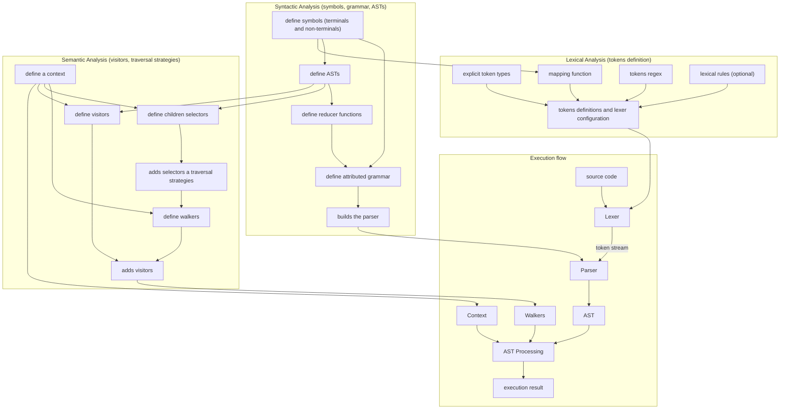

# Tutorial — Arithmetic REPL


<!-- source: docs/tutorials/complete-languages/arithmetic-repl/arithmetic-repl-intro.md -->

# First approach

For our first tutorial of a complete language, let's create a simple [**REPL**](https://en.wikipedia.org/wiki/Read%E2%80%93eval%E2%80%93print_loop) for arithmetic expressions that supports variable declarations and a few built-in functions. By the end, you'll have a working interpreter and a clear understanding of how PyLGEN's components fit together.

> ## What we're building
A **REPL** that evaluates expressions like:

```python
>>> x = 10
>>> y = x * 2 + 5
>>> y
25
>>> exit()
```

The language supports:

 - Arithmetic: `+`,`-`,`*`,`/`,`**`,`%`.
 - Parentheses and operator precedence.
 - Variables (assignment and usage).
 - Built-in commands: `exit()` and `clear()`.

We'll build it in four steps, following the classic compiler pipeline: **Lexer** -> **Parser** -> **Semantic Analysis** -> **Execution**. The project file structure is organized as follows:

    arithmetic_interpreter
        |--- asts.py
        |--- context.py
        |--- errors.py
        |--- grammar_symbols.py
        |--- grammar.py
        |--- lexer.py
        |--- reductors.py
        |--- semantic.py
        |--- visitors.py
    main.py

> **NOTE: Sources**
The source code of the entire tutorial can be found on the [github repository](https://github.com/YonyUk/pylgen/tree/master/examples/arithmetic_interpreter)

[download source code<br>(arithmetic_interpreter)](https://download-directory.github.io/?url=https://github.com/YonyUk/pylgen/tree/master/examples/arithmetic_interpreter){ .md-button .md-button--primary style="text-align: center;"}

Let's dive in and start building!


<!-- source: docs/tutorials/complete-languages/arithmetic-repl/arithmetic-repl-step-1.md -->

# Step 1: Build the lexer

The lexer converts source code into a stream of tokens. We define token types, regular expressions, and optional validation rules.

## Define token types

First, we declare the token types that our language will use:

```python
from pylgen.common.enums import TokenType

# Enumeration of token types of our language
class TokenTypeEnum(TokenType):
    NUMBER = 'NUMBER'
    SYMBOL = 'SYMBOL'
    OPERATOR = 'OPERATOR'
    VARIABLE = 'VARIABLE'
    KEYWORD = 'KEYWORD'

```

## Define the mapping function

To connect the lexer's output with the grammar rules, we need a mapping function that translates each token (type + lexeme) into a grammar symbol. This function bridges the gap between the lexer's raw token patterns and the grammar's terminal symbols, allowing the lexer to remain generic while precisely mapping each recognized token to the specific symbol the parser expects.

```python
from pylgen.common.types import Symbol
# this will be defined later
from .grammar_symbols import (
    END_SYMBOL,
    number,
    variable
)

# ...

def get_symbol_function(t:TokenTypeEnum,tx:str) -> Symbol:
    if t == TokenTypeEnum.NUMBER:
        return number
    if t == TokenTypeEnum.SYMBOL:
        return Symbol(tx,True)
    if t == TokenTypeEnum.VARIABLE:
        return variable
    if t == TokenTypeEnum.KEYWORD:
        return Symbol(tx,True)
    return Symbol(tx,True)
```

> **IMPORTANT**
It is important that the mapping function is fully annotated so that the lexer can infer the enum type; otherwise, the lexer may fail.

Here, we receive a token type and its lexeme (tx), and return the corresponding grammar symbol.

## Creating the lexer

Now we can instantiate the lexer. It takes our mapping function and a regular expression that defines which tokens (e.g., whitespace, new lines, comments) should be discarded. We also explicitly define the end‑of‑file token to mark the end of the input stream.

```python
from pylgen.lexer.lexer import Lexer

# ...

lexer = Lexer(get_symbol_function,r'\s+')
lexer.set_eof_token(END_SYMBOL,TokenTypeEnum.SYMBOL)
```

## Defining tokens

Next, we associate regular expression patterns with their corresponding token types, ordered by priority.

```python
# ...

lexer[0,TokenTypeEnum.NUMBER] = r'\d+(\.\d+)?'
lexer[1,TokenTypeEnum.SYMBOL] = r'\(|\)'
lexer[2,TokenTypeEnum.OPERATOR] = r'\+|\*\*?|\-|/|%|='
lexer[3,TokenTypeEnum.KEYWORD] = 'exit|clear'
lexer[4,TokenTypeEnum.VARIABLE] = r'\w+'
```

## Lexical rules

Optionally, we can add validation rules to enforce lexical constraints beyond simple pattern matching. For example, we can ensure numbers are properly formatted and variable names do not start with a digit.

```python
from pylgen.analysis.lexical import LexicalRule

# ...

class NumberLexicalRule(LexicalRule):

    def __init__(self) -> None:
        super().__init__('number must be 0 or star with a non-zero digit')
    
    def _check(self, text: str):
        if '.' in text:
            return str(float(text)) == text
        return str(int(text)) == text

class VariableLexicalRule(LexicalRule):

    def __init__(self) -> None:
        super().__init__('variables names can\'t star with a number')
    
    def _check(self, text: str):
        return not text[0].isdigit()

# ...

lexer.add_rule(TokenTypeEnum.NUMBER,NumberLexicalRule())
lexer.add_rule(TokenTypeEnum.VARIABLE,VariableLexicalRule())
```

## Recap

Putting it all together, here is the complete `lexer.py` module:

File: `lexer.py`
```python
from pylgen.common.enums import TokenType
from pylgen.common.types import Symbol
from pylgen.lexer.lexer import Lexer
from pylgen.analysis.lexical import LexicalRule
from .grammar_symbols import (
    END_SYMBOL,
    number,
    variable
)

# Enumeration of token types of our language
class TokenTypeEnum(TokenType):
    NUMBER = 'NUMBER'
    SYMBOL = 'SYMBOL'
    OPERATOR = 'OPERATOR'
    VARIABLE = 'VARIABLE'
    KEYWORD = 'KEYWORD'

class NumberLexicalRule(LexicalRule):

    def __init__(self) -> None:
        super().__init__('number must be 0 or star with a non-zero digit')

    def _check(self, text: str):
        if '.' in text:
            return str(float(text)) == text
        return str(int(text)) == text

class VariableLexicalRule(LexicalRule):

    def __init__(self) -> None:
        super().__init__('variables names can\'t star with a number')

    def _check(self, text: str):
        return not text[0].isdigit()

def get_symbol_function(t:TokenTypeEnum,tx:str) -> Symbol:
    if t == TokenTypeEnum.NUMBER:
        return number
    if t == TokenTypeEnum.SYMBOL:
        return Symbol(tx,True)
    if t == TokenTypeEnum.VARIABLE:
        return variable
    if t == TokenTypeEnum.KEYWORD:
        return Symbol(tx,True)
    return Symbol(tx,True)

lexer = Lexer(get_symbol_function,'\n|\t| ')
lexer.set_eof_token(END_SYMBOL,TokenTypeEnum.SYMBOL)

lexer[0,TokenTypeEnum.NUMBER] = r'\d+(\.\d+)?'
lexer[1,TokenTypeEnum.SYMBOL] = r'\(|\)'
lexer[2,TokenTypeEnum.OPERATOR] = r'\+|\*\*?|\-|/|%|='
lexer[3,TokenTypeEnum.KEYWORD] = 'exit|clear'
lexer[4,TokenTypeEnum.VARIABLE] = r'\w+'

lexer.add_rule(TokenTypeEnum.NUMBER,NumberLexicalRule())
lexer.add_rule(TokenTypeEnum.VARIABLE,VariableLexicalRule())
```

Our lexer is now ready to tokenize input. Next, we’ll move on to defining the grammar and building the parser.


<!-- source: docs/tutorials/complete-languages/arithmetic-repl/arithmetic-repl-step-2.md -->

# Step 2: Build the parser (Syntactic Analysis – Defining the Grammar)

With our lexer up and running, we now have a clean stream of tokens. But having the pieces is only half the battle, we also need to know how they fit together. For instance, `x = 10` makes perfect sense, while `= x 10` clearly doesn't. To define these structural rules, we move on to syntactic analysis.

In this step, we'll establish the grammar of our language: a set of rules that determines which sequences of tokens are valid. We'll begin by naming the basic building blocks (like numbers and variables) and then write the rules that specify how to combine them into assignments, expressions, and built-in commands.

As the parser processes the token stream and checks it against these rules, it doesn't just validate the input, it also builds a structured representation of your code called an **Abstract Syntax Tree (AST)**. Think of the AST as a simplified, hierarchical map of your program: it strips away superficial details like parentheses or whitespace and captures only the meaningful structure. For example, the parser will transform `x = 10` into a distinct node representing an assignment, with `x` on one side and `10` on the other. We'll define these node structures upfront, so the parser knows exactly what shape to produce.

The files we'll be working on are:

 - `grammar_symbols.py`: where we define the fundamental symbols.
 - `grammar.py`: where we write the combination rules, set up the parser, and tell it which AST nodes to build.
 - `asts.py`: where we define the node structure for our AST.
 - `reductors.py`: where we define how to build each AST node.

Let's start by declaring our basic building blocks.

## Grammar symbols

With the overall structure in mind, let's start by declaring the actual symbols of our grammar. These symbols, both terminals (like `+` or `number`) and non-terminals (like `E` for expression), will serve as the alphabet for our syntactic rules.

Before we dive into the code, it's helpful to distinguish between the two types of symbol we'll encounter:

 - **Terminals** are the actual tokens that appear in your source code, things like `+`,`-`,`number`, or `variable`. They are the "atoms" of your language; the parser consumes them directly from lexer's output, and they cannot be broken down further. Think of them as the **words** of your language.
 - **Non-terminals** are abstract categories that represents groups of terminals and/or other non-terminals. They don't appear directly in the source code; instead, they are placeholders that the parser uses to build structure. For example, `E` (expression) or `T` (term) are non-terminals, they stand for a pattern of symbols that, when expanded through grammar rules, eventually produce actual terminals. Think of them as **gramatical categories** (like "noun phrase" in natural language).

In practice, terminals are written with lowercase style (or quoted), while non-terminals are often uppercase, though this is just a convention. You can spot terminals in our list by the `True` flag passed to symbol, that's how PyLGEN knows they are not expandable.

File `grammar_symbols.py`
```python
from pylgen.common.types import Symbol

END_SYMBOL = '$'

ArithmeticExpression = Symbol('ArithmeticExpression')
E = Symbol('E')
T = Symbol('T')
F = Symbol('F')
P = Symbol('P')
VAR = Symbol('VAR')

plus = Symbol('+',True)
minus = Symbol('-',True)
mod = Symbol('%',True)
mul = Symbol('*',True)
div = Symbol('/',True)
exp = Symbol('**',True)
number = Symbol('number',True)
lp = Symbol('(',True)
rp = Symbol(')',True)
eq = Symbol('=',True)
variable = Symbol('variable',True)
exit = Symbol('exit',True)
clear = Symbol('clear',True)
```

## Defining the AST nodes

Parallel to defining the grammar, we need to decide how the parser will represent valid programs. Instead of simply reporting "valid", we want it to produce a structured, easy‑to‑traverse tree. This is where our **Abstract Syntax Tree (AST)** nodes come into play.

We'll start by defining a base BinaryAST class that captures any binary operation. All specific binary nodes (like addition, multiplication, or assignment) will inherit from it, which saves us from repeating common logic.

File `asts.py`
```python
from typing import List

from pylgen.common.types import AST,Symbol,ErrorAST,SemanticError, Token
from .grammar_symbols import (
    clear,
    plus,
    minus,
    mul,
    mod,
    div,
    exp,
    eq,
    variable,
    exit
)

div_error = Symbol('Division SemanticError')
mod_error = Symbol('Module SemanticError')

class BinaryAST(AST):

    def __init__(self, left:AST,right:AST,symbol: Symbol):
        (sl,sc),(el,ec) = left.start_position,right.end_position
        super().__init__(symbol,sl,sc,el,ec)
        self._left:AST = left
        self._right:AST = right

    @property
    def left(self) -> AST:
        return self._left # type:ignore

    @property
    def right(self) -> AST:
        return self._right # type: ignore

    def children(self) -> List[AST]:
        return [self._left,self._right]
```

> **NOTE: Inherited positions**
Note that `BinaryAST` derives its full range from its children: it starts where the left operand begins and ends where the right one ends. This keeps position information consistent without requiring each reducer to calculate it manually.

Now we can create a dedicated node for each binary operation, simply forwarding the operands and the corresponding symbol:

```python
class PlusAST(BinaryAST):

    def __init__(self, left:AST,right:AST):
        super().__init__(left,right,plus)

class MinusAST(BinaryAST):

    def __init__(self, left:AST,right:AST):
        super().__init__(left,right,minus)

class ModAST(BinaryAST):

    def __init__(self, left:AST,right:AST):
        super().__init__(left,right,mod)

class ModuleByZeroErrorAST(ErrorAST):

    def __init__(self,left:AST,right:AST):
        (sl,sc),(el,ec) = left.start_position,right.end_position
        errors = {SemanticError('module by zero not allowed',sl,sc,el,ec)}
        super().__init__(mod_error,sl,sc,el,ec,errors)
        self._left = left
        self._right = right

    def children(self) -> List[AST]:
        return [self._left,self._right]

class ModuleByNotIntegerErrorAST(ErrorAST):

    def __init__(self,left:AST,right:AST):
        (sl,sc),(el,ec) = left.start_position,right.end_position 
        errors = {SemanticError('module by a non-integer not allowed',sl,sc,el,ec)}
        super().__init__(mod_error,sl,sc,el,ec,errors)
        self._left = left
        self._right = right

    def children(self) -> List[AST]:
        return [self._left,self._right]

class MulAST(BinaryAST):

    def __init__(self, left:AST,right:AST):
        super().__init__(left,right,mul)

class DivAST(BinaryAST):

    def __init__(self, left:AST,right:AST):
        super().__init__(left,right,div)

class DivisionByZeroErrorAST(ErrorAST):

    def __init__(self,left:AST,right:AST):
        (sl,sc),(el,ec) = left.start_position,right.end_position
        errors = {SemanticError('division by zero not allowed',sl,sc,el,ec)}
        super().__init__(div_error,sl,sc,el,ec,errors)
        self._left = left
        self._right = right

    def children(self) -> List[AST]:
        return [self._left,self._right]

class ExpAST(BinaryAST):

    def __init__(self, left:AST,right:AST):
        super().__init__(left,right,exp)
```

> **NOTE: Why `ErrorAST`?**
`ErrorAST` is a special AST node provided by PyLGEN that carries a set of `SemanticError` objects. It allows us to embed static error information directly into the syntax tree during parsing; for instance, when a literal zero is used as the divisor or modulo operand. By returning an `ErrorAST` from a reductor, we detect these errors as early as possible, without needing a separate semantic pass to re‑check the same conditions. This keeps the semantic analysis phase lean and focused on dynamic errors like undeclared variables.

> **TIP: Why subclasses of `ErrorAST` instead of using `ErrorAST` directly?**
We need to **preserve contextual information** from the source code (operands, error type, location). A generic `ErrorAST` node only holds a set of errors, but does not distinguish *what* failed or *with which* values. Creating specific subclasses (`DivisionByZeroErrorAST`, etc.) allows us to:

 - Identify the error precisely in later phases (recovery, reporting).

 - Store the involved operands for complete diagnostics.

 - Keep the AST rich in metadata, as compiler theory recommends: error nodes should be **specialized** to convey semantic information and enable recovery strategies without losing context.

This design avoids having the error system reconstruct lost information and aligns with best practices in syntactic and semantic analysis.

For assignments, we follow the same binary structure. However, note that we override the children method to return only the right‑hand side, this is a design choice to simplify later tree traversals by treating the variable name as metadata rather than a child node.

```python
class AssignmentAST(BinaryAST):

    def __init__(self, left: AST, right: AST):
        super().__init__(left, right, eq)

    def children(self) -> List[AST]:
        return [self._right]
```

Finally, we define leaf‑like nodes for variable references and our built‑in commands:

```python 
class VarAST(AST):

    def __init__(self,token:Token):
        (sl,sc),(el,ec) = token.start_position,token.end_position
        super().__init__(variable,sl,sc,el,ec)
        self._name = token.text

    @property
    def name(self) -> str:
        return self._name

    def children(self) -> List[AST]:
        return []

class ExitAST(AST):

    def __init__(self,start_line:int,start_column:int,end_line:int,end_column:int):
        super().__init__(exit, start_line,start_column,end_line,end_column)

    def children(self) -> List[AST]:
        return []

class ClearAST(AST):

    def __init__(self,start_line:int,start_column:int,end_line:int,end_column:int):
        super().__init__(clear, start_line,start_column,end_line,end_column)

    def children(self) -> List[AST]:
        return []
```

Putting it all together, here is the complete `asts.py` module:

File `asts.py`
```python
from typing import List

from pylgen.common.types import AST,Symbol,ErrorAST,SemanticError, Token
from .grammar_symbols import (
    clear,
    plus,
    minus,
    mul,
    mod,
    div,
    exp,
    eq,
    variable,
    exit
)

div_error = Symbol('Division SemanticError')
mod_error = Symbol('Module SemanticError')

class BinaryAST(AST):

    def __init__(self, left:AST,right:AST,symbol: Symbol):
        (sl,sc),(el,ec) = left.start_position,right.end_position
        super().__init__(symbol,sl,sc,el,ec)
        self._left:AST = left
        self._right:AST = right

    @property
    def left(self) -> AST:
        return self._left # type:ignore

    @property
    def right(self) -> AST:
        return self._right # type: ignore

    def children(self) -> List[AST]:
        return [self._left,self._right]

class PlusAST(BinaryAST):

    def __init__(self, left:AST,right:AST):
        super().__init__(left,right,plus)

class MinusAST(BinaryAST):

    def __init__(self, left:AST,right:AST):
        super().__init__(left,right,minus)

class ModAST(BinaryAST):

    def __init__(self, left:AST,right:AST):
        super().__init__(left,right,mod)

class ModuleByZeroErrorAST(ErrorAST):

    def __init__(self,left:AST,right:AST):
        (sl,sc),(el,ec) = left.start_position,right.end_position
        errors = {SemanticError('module by zero not allowed',sl,sc,el,ec)}
        super().__init__(mod_error,sl,sc,el,ec,errors)
        self._left = left
        self._right = right

    def children(self) -> List[AST]:
        return [self._left,self._right]

class ModuleByNotIntegerErrorAST(ErrorAST):

    def __init__(self,left:AST,right:AST):
        (sl,sc),(el,ec) = left.start_position,right.end_position 
        errors = {SemanticError('module by a non-integer not allowed',sl,sc,el,ec)}
        super().__init__(mod_error,sl,sc,el,ec,errors)
        self._left = left
        self._right = right

    def children(self) -> List[AST]:
        return [self._left,self._right]

class MulAST(BinaryAST):

    def __init__(self, left:AST,right:AST):
        super().__init__(left,right,mul)

class DivAST(BinaryAST):

    def __init__(self, left:AST,right:AST):
        super().__init__(left,right,div)

class DivisionByZeroErrorAST(ErrorAST):

    def __init__(self,left:AST,right:AST):
        (sl,sc),(el,ec) = left.start_position,right.end_position
        errors = {SemanticError('division by zero not allowed',sl,sc,el,ec)}
        super().__init__(div_error,sl,sc,el,ec,errors)
        self._left = left
        self._right = right

    def children(self) -> List[AST]:
        return [self._left,self._right]

class ExpAST(BinaryAST):

    def __init__(self, left:AST,right:AST):
        super().__init__(left,right,exp)

class AssignmentAST(BinaryAST):

    def __init__(self, left: AST, right: AST):
        super().__init__(left, right, eq)

    def children(self) -> List[AST]:
        return [self._right]

class VarAST(AST):

    def __init__(self,token:Token):
        (sl,sc),(el,ec) = token.start_position,token.end_position
        super().__init__(variable,sl,sc,el,ec)
        self._name = token.text

    @property
    def name(self) -> str:
        return self._name

    def children(self) -> List[AST]:
        return []

class ExitAST(AST):

    def __init__(self,start_line:int,start_column:int,end_line:int,end_column:int):
        super().__init__(exit, start_line,start_column,end_line,end_column)

    def children(self) -> List[AST]:
        return []

class ClearAST(AST):

    def __init__(self,start_line:int,start_column:int,end_line:int,end_column:int):
        super().__init__(clear, start_line,start_column,end_line,end_column)

    def children(self) -> List[AST]:
        return []
```

With our symbols and AST nodes ready, we're all set to write the actual grammar rules and connect the parser in the next section.

## Designing our language

With our symbols and AST nodes ready, it's time to define the actual grammar rules. This is where we specify how the tokens can be combined to form valid expressions, assignments, and commands, and, crucially, which AST nodes should be built for each valid combination.

We'll use PyLGEN's [`AttributedGrammar`](../../../user-guide/user-guide-grammar.md#attributedgrammar) class, which allows us to attach a **reductor** (a function) to each production. This reductor will be called during parsing whenever that production is recognized; its job is to take the children (the ASTs of the symbols on the right‑hand side) and produce a new AST node for the left‑hand side.

Let's start by importing everything we need and creating the grammar object.

```python
from pylgen.parser.parser_builder import ParserBuilder
from pylgen.parser.parser_type import ParserType
from pylgen.grammar.grammar import AttributedGrammar
from .grammar_symbols import (
    END_SYMBOL,
    VAR,
    ArithmeticExpression,
    E,
    T,
    F,
    P,
    plus,
    minus,
    mul,
    div,
    exp,
    mod,
    lp,
    rp,
    number,
    variable,
    eq,
    exit,
    clear
)
from .reductors import (
    binary_reductor,
    single_reductor,
    parenthesis_reductor,
    variable_reductor,
    exit_reductor,
    clear_reductor
)

# Create the attributed grammar with the start symbol and end marker
G = AttributedGrammar(ArithmeticExpression, END_SYMBOL)
```

Now we add the production rules. Each rule has the form:
```python
G[NonTerminal] += (symbol1, symbol2, ...), reductor_function
```

> ### ArithmeticExpression -  the top-level rule

We define three possible forms for a complete input:

`1` - A simple expression (like 3 + 5).

`2` - A variable assignment (like x = 10).

`3` - A built-in command ( `exit()` or `clear()`).

```python
# ...

G[ArithmeticExpression] += (E,), single_reductor
G[ArithmeticExpression] += (VAR, eq, E), binary_reductor
G[ArithmeticExpression] += (exit, lp, rp), exit_reductor
G[ArithmeticExpression] += (clear, lp, rp), clear_reductor
```

> ### Expression rules (**E**,**T**,**F**,**P**)

We follow the classic precedence hierarchy:

 - `E`: handles addition and substraction (lowest precedence).
 - `T`: handles multiplication, division and modulo.
 - `F`: handles exponentiation.
 - `P`: handles parentheses and atomic values (numbers and variables)

```python
G[E] += (E, plus, T), binary_reductor
G[E] += (E, minus, T), binary_reductor
G[E] += (T,), single_reductor

G[T] += (T, mul, F), binary_reductor
G[T] += (T, div, F), binary_reductor
G[T] += (T, mod, F), binary_reductor
G[T] += (F,), single_reductor

G[F] += (F, exp, P), binary_reductor
G[F] += (P,), single_reductor

G[P] += (lp, E, rp), parenthesis_reductor
G[P] += (number,), single_reductor
G[P] += (VAR,), single_reductor
```

> ### Variable production

Finally, we define how a **VAR** non‑terminal is derived from the terminal variable. This rule will be used inside assignments and simple variable references.

```python
G[VAR] += (variable,), variable_reductor
```

> ### Building the parser

Once all rules are in place, we instruct PyLGEN to construct an LALR(1) parser from our attributed grammar. The resulting parser will be able to parse any valid input and produce an AST.

```python
parser = ParserBuilder.build_parser_from_attributed(G, ParserType.LALR1)
```

> **NOTE**
In this file, we are importing `binary_reductor`, `single_reductor`, and the others from the reductors module. We haven't written them yet, we'll do that in the next step. For now, it's enough to know that each reductor receives a view over a list of child AST nodes (and their associated symbols) and returns a new AST node for the left‑hand side. For example, `binary_reductor` will combine two operands with an operator to produce a `PlusAST`, `MinusAST`, or similar, depending on the specific production.

With the grammar defined and the parser built, we're almost ready to start evaluating code. The next logical step is implementing the reductors themselves, which will bridge the gap between the syntactic structure and the actual AST nodes we designed earlier.

> ### Recap

File: `grammar.py`
```python
from pylgen.parser.parser_builder import ParserBuilder
from pylgen.parser.parser_type import ParserType
from pylgen.grammar.grammar import AttributedGrammar
from .grammar_symbols import (
    END_SYMBOL,
    VAR,
    ArithmeticExpression,
    E,
    T,
    F,
    P,
    plus,
    minus,
    mul,
    div,
    exp,
    mod,
    lp,
    rp,
    number,
    variable,
    eq,
    exit,
    clear
)
from .reductors import (
    binary_reductor,
    single_reductor,
    parenthesis_reductor,
    variable_reductor,
    exit_reductor,
    clear_reductor
)

# Create the attributed grammar with the start symbol and end marker
G = AttributedGrammar(ArithmeticExpression, END_SYMBOL)

G[ArithmeticExpression] += (E,), single_reductor
G[ArithmeticExpression] += (VAR, eq, E), binary_reductor
G[ArithmeticExpression] += (exit, lp, rp), exit_reductor
G[ArithmeticExpression] += (clear, lp, rp), clear_reductor

G[E] += (E, plus, T), binary_reductor
G[E] += (E, minus, T), binary_reductor
G[E] += (T,), single_reductor

G[T] += (T, mul, F), binary_reductor
G[T] += (T, div, F), binary_reductor
G[T] += (T, mod, F), binary_reductor
G[T] += (F,), single_reductor

G[F] += (F, exp, P), binary_reductor
G[F] += (P,), single_reductor

G[P] += (lp, E, rp), parenthesis_reductor
G[P] += (number,), single_reductor
G[P] += (VAR,), single_reductor

G[VAR] += (variable,), variable_reductor

parser = ParserBuilder.build_parser_from_attributed(G, ParserType.LALR1)
```

## Connecting the Dots (The reductors)

In the previous step, we defined our grammar rules but left the reductors as placeholders. Now it's time to bring them to life.

A **reductor** is a function that receives an inmutable view over a list of AST nodes (or tokens) produced by the right‑hand side of a production and returns a single AST node for the left‑hand side. In essence, it's the builder that assembles our tree structure as the parser reduces the input. Each reductor knows exactly how to combine its children into a meaningful parent node.

Let's implement each one step by step. First, let's make a few imports:

```python
from pylgen.common.types import AST,ASTListView,Token
from .grammar_symbols import (
    minus,
    plus,
    mul,
    div,
    exp,
    mod,
    eq,
    variable,
    number
)
from .asts import (
    ClearAST,
    PlusAST,
    MinusAST,
    MulAST,
    DivAST,
    ExpAST,
    ModAST,
    VarAST,
    AssignmentAST,
    ExitAST,
    DivisionByZeroErrorAST,
    ModuleByNotIntegerErrorAST,
    ModuleByZeroErrorAST
)
```

> ### The Binary Reductor

The `binary_reductor` handles all binary operations: addition, subtraction, multiplication, division, exponentiation, modulo, and assignment. It inspects the symbol of the middle child (`asts[1]`), which is the operator token, to determine which AST class to instantiate. It then constructs the new node using the left child (`asts[0]`), the right child (`asts[2]`).

```python
# ...
def binary_reductor(asts:ASTListView) -> AST:
    ast_type:type = None  # type: ignore
    if asts[1].symbol == plus:
        ast_type = PlusAST
    elif asts[1].symbol == minus:
        ast_type = MinusAST
    elif asts[1].symbol == mul:
        ast_type = MulAST
    elif asts[1].symbol == div:
        right = asts[2]
        if isinstance(right,Token) and float(right.text) == 0:
            return DivisionByZeroErrorAST(asts[0],asts[2])
        ast_type = DivAST
    elif asts[1].symbol == exp:
        ast_type = ExpAST
    elif asts[1].symbol == mod:
        right = asts[2]
        if isinstance(right,Token):
            if float(right.text) == 0:
                return ModuleByZeroErrorAST(asts[0],asts[2])
            if '.' in right.text:
                return ModuleByNotIntegerErrorAST(asts[0],asts[2])
        ast_type = ModAST
    elif asts[1].symbol == eq:
        ast_type = AssignmentAST
    else:
        raise ValueError()
    return ast_type(asts[0],asts[2])
```

> ### The Single Reductor

This is the simplest reductor: it just forwards the single child it receives. It's used in rules where a non‑terminal directly maps to another non‑terminal (like `E -> T` or `F -> P`).

```python
def single_reductor(asts:ASTListView) -> AST:
    return asts[0]
```

> ### The Parenthesis Reductor

When the parser encounters `( E )`, this reductor extracts the inner expression (`asts[1]`) and discards the parentheses tokens. This effectively removes the parentheses from the AST, keeping only the meaningful content.

```python
def parenthesis_reductor(asts:ASTListView) -> AST:
    asts[1].start_position = asts[0].start_position
    asts[1].end_position = asts[2].end_position
    return asts[1]
```

> **TIP: Details on `parenthesis_reductor`**
Since the internal AST (`asts[1]`) already has its own position information (that of the number or variable), we now extend its range to include the enclosing parentheses. This way, if an error regarding that subexpression is reported later, the message will correctly point to the span from `(` to `)`.

> ### The Variable Reductor

This reductor creates a `VarAST` node from the raw token's text and its positional information. The token's text attribute holds the actual variable name (e.g., "x" or "counter").

```python
def variable_reductor(asts:ASTListView) -> AST:
    return VarAST(asts[0]) # type: ignore
```

> ### Command Reductors

Finally, we have two reductors for our built‑in commands: `exit()` and `clear()`. Both simply create the corresponding AST node, using the command token's line and column for error reporting purposes.

```python
def exit_reductor(asts:ASTListView) -> AST:
    (sl,sc),(el,ec) = asts[0].start_position,asts[2].end_position
    return ExitAST(sl,sc,el,ec)

def clear_reductor(asts:ASTListView) -> AST:
    (sl,sc),(el,ec) = asts[0].start_position,asts[2].end_position
    return ClearAST(sl,sc,el,ec)
```

> **NOTE: Command reducers**
Both `exit_reductor` and `clear_reductor` construct the range from the initial token (`exit` / `clear`) and the closing parenthesis (`asts[2]`). In this way, the node covers exactly `exit()` or `clear()` as a whole.

> ### Putting It All Together

File: `reductors.py`
```python
from pylgen.common.types import AST,ASTListView,Token
from .grammar_symbols import (
    minus,
    plus,
    mul,
    div,
    exp,
    mod,
    eq,
    variable,
    number
)
from .asts import (
    ClearAST,
    PlusAST,
    MinusAST,
    MulAST,
    DivAST,
    ExpAST,
    ModAST,
    VarAST,
    AssignmentAST,
    ExitAST,
    DivisionByZeroErrorAST,
    ModuleByNotIntegerErrorAST,
    ModuleByZeroErrorAST
)

def binary_reductor(asts:ASTListView) -> AST:
    ast_type:type = None  # type: ignore
    if asts[1].symbol == plus:
        ast_type = PlusAST
    elif asts[1].symbol == minus:
        ast_type = MinusAST
    elif asts[1].symbol == mul:
        ast_type = MulAST
    elif asts[1].symbol == div:
        right = asts[2]
        if isinstance(right,Token) and float(right.text) == 0:
            return DivisionByZeroErrorAST(asts[0],asts[2])
        ast_type = DivAST
    elif asts[1].symbol == exp:
        ast_type = ExpAST
    elif asts[1].symbol == mod:
        right = asts[2]
        if isinstance(right,Token):
            if float(right.text) == 0:
                return ModuleByZeroErrorAST(asts[0],asts[2])
            if '.' in right.text:
                return ModuleByNotIntegerErrorAST(asts[0],asts[2])
        ast_type = ModAST
    elif asts[1].symbol == eq:
        ast_type = AssignmentAST
    else:
        raise ValueError()
    return ast_type(asts[0],asts[2])

def single_reductor(asts:ASTListView) -> AST:
    return asts[0]

def parenthesis_reductor(asts:ASTListView) -> AST:
    asts[1].start_position = asts[0].start_position
    asts[1].end_position = asts[2].end_position
    return asts[1]

def variable_reductor(asts:ASTListView) -> AST:
    return VarAST(asts[0]) # type: ignore

def exit_reductor(asts:ASTListView) -> AST:
    (sl,sc),(el,ec) = asts[0].start_position,asts[2].end_position
    return ExitAST(sl,sc,el,ec)

def clear_reductor(asts:ASTListView) -> AST:
    (sl,sc),(el,ec) = asts[0].start_position,asts[2].end_position
    return ClearAST(sl,sc,el,ec)
```


<!-- source: docs/tutorials/complete-languages/arithmetic-repl/arithmetic-repl-step-3.md -->

# Step 3: Bringing Meaning to the Tree (Semantic Analysis)

With our AST ready and our parser validated, we've reached the stage where we move beyond structure and into **meaning**. Lexical and syntactic analysis tell us ***how*** the code is written; [semantic analysis](../../../user-guide/user-guide-analysis.md) tells us ***what*** it means and ***whether*** it makes sense.

In a typical compiler pipeline, semantic analysis handles tasks like:

 - **Type checking**: ensuring operations are performed on compatible types.
 - **Scope resolution**: verifying that variables are declared before use.
 - **Error detection**: cacthing nonsensical operations like division by zero at compile time (when possible).

For our REPL, we'll also combine **semantic analysis** with **evaluation**, after all, we're building an **interpreter**. But before we compute values, we must ensure that the computation is valid.

## The Context (Managing State)

Every interpreter needs a way to store and retrieve information during execution. Our `ArithmeticExpressionContext` class, defined in `context.py` serves as the central repository for all runtime state:

 - **Variables storage**: a dictionary (`_variables`) that maps variable names to their current values.
 - **AST value caching**: a dictionary (`_values`) that associates each AST node with its evaluated result or, if an error ocurred, the error itself.
 - **Error management**: methods to add, retrieve, and clear errors.

File: `context.py`
```python
from typing import List,Any,Dict
from pylgen.common.types import AST,RuntimeError
from pylgen.analysis.context import Context

from .asts import VarAST

class ArithmeticExpressionContext(Context):

    def __init__(self) -> None:
        super().__init__()
        self._variables:Dict[str,Any] = {}
        self._values:Dict[AST,Any] = {}

    def reset(self) -> None:
        super().reset()
        self._variables.clear()
        self._values.clear()

    def clear_garbage(self) -> None:
        super().clear_errors()
        self._values.clear()

    def define_variable(self,var_name:str):
        self._variables[var_name] = None

    def check_variable_in_context(self,var_name:str) -> bool:
        return var_name in self._variables

    def add_runtime_error(self, ast: AST, error: RuntimeError) -> None:
        self._values[ast] = error

    # the base method Context.clear_runtime_errors() raises NotImplementedError()
    def clear_runtime_errors(self) -> None:
        pass

    def get_runtime_errors(self) -> List[RuntimeError]:
        return [value for value in self._values.values() if isinstance(value,RuntimeError)]

    def add_variable(self,name:str,value:Any) -> None:
        self._variables[name] = value

    def exists_variable(self,name:str) -> bool:
        return name in self._variables

    def get_variable_value(self,name:str) -> Any:
        return self._variables[name]

    def add_ast_value(self,ast:AST,value:Any) -> None:
        self._values[ast] = value

    def get_ast_value(self,ast:AST) -> Any:
        if isinstance(ast,VarAST):
            return self._variables[ast.name]
        return self._values.get(ast,None)
```

This context will be passed to every visitor, providing a shared environment for both semantic error collection and evaluation.

## Custom Runtime Errors

Our language supports a handful of arithmetic operations, and each comes with its own set of pitfalls. We define dedicated error classes in `errors.py` to provide precise, informative feedback:

 - `DivisionByZeroError`: raised when attempting to divide by zero.
 - `ModuleByZeroError`: raised when the right operand of `%` is zero.
 - `ModuleByNotIntegerError`: raised when the right operand of `%` is not an integer.
 - `ModuleWithComplexNumberError`: raised when either operand of `%` is a complex number.

Each error carries a stack trace, line number, column number, and a descriptive message, making debugging straightforward.

File: `errors.py`
```python
from typing import List
from pylgen.common.types import RuntimeError

class DivisionByZeroError(RuntimeError):

    def __init__(self, stack_trace: List[str], start_line: int, start_column: int, end_line: int, end_column: int) -> None:
        super().__init__(stack_trace, start_line, start_column, end_line, end_column, 'division by zero not allowed')

class ModuleByZeroError(RuntimeError):

    def __init__(self, stack_trace: List[str], start_line: int, start_column: int, end_line: int, end_column: int) -> None:
        super().__init__(stack_trace, start_line, start_column, end_line, end_column, 'module by zero not allowed')

class ModuleByNotIntegerError(RuntimeError):

    def __init__(self, stack_trace: List[str], start_line: int, start_column: int, end_line: int, end_column: int) -> None:
        super().__init__(stack_trace, start_line, start_column, end_line, end_column, 'module by a not-integer not allowed')

class ModuleWithComplexNumberError(RuntimeError):

    def __init__(self, stack_trace: List[str], start_line: int, start_column: int, end_line: int, end_column: int) -> None:
        super().__init__(stack_trace, start_line, start_column, end_line, end_column, 'module operation not supported for complex numbers')
```

## The **Visitor Pattern** (Separating Concerns)

Rather than cluttering our AST nodes with evaluation logic, we adopt the **Visitor Pattern**. Each node type has one or more dedicated visitor classes that know how to process it. This keeps our AST definitions clean and makes it easy to add new operations (e.g., pretty-printing, type checking, optimization) without modifying existing nodes.

PyLGEN provides the `ASTVisitor` base class, and we extend it for our specific needs.

> ### Semantic Error Collectors

Before evaluating anything, we run a **semantic error collection** pass. These visitors traverse the AST and llok for issues that can be detected statically, without executing the code:

 - `VariableASTSemanticErrorCollectorVisitor`: checks that the variable was declared previously.
 - `AssignmentASTSemanticErrorCollector`:  checks that the right-hand side of an assignment doesn't reference an undeclared variable.

These collectors add `SemanticError` objects to the context, which we can report to the user before any evaluation takes place. This early detection prevents runtime surprises.

File: `visitors.py`
```python
from pylgen.common.types import AST,Token,SemanticError
from pylgen.analysis.visitor import ASTVisitor
from .context import ArithmeticExpressionContext

from .grammar_symbols import *

class VariableASTSemanticErrorCollectorVisitor(ASTVisitor):

    def __init__(self) -> None:
        super().__init__(ArithmeticExpressionContext)

    def visit(self, ast: VarAST, context: ArithmeticExpressionContext) -> None:
        self._check_context_type(context)
        if not context.check_variable_in_context(ast.name):
            (sl,sc),(el,ec) = ast.start_position,ast.end_position
            error = SemanticError(f'undeclared variable "{ast.name}"',sl,sc,el,ec)
            context.add_semantic_error(error)

class AssignmentASTSemanticErrorCollectorVisitor(ASTVisitor):

    def __init__(self) -> None:
        super().__init__(ArithmeticExpressionContext)

    def visit(self, ast: AssignmentAST, context: ArithmeticExpressionContext) -> None:
        self._check_context_type(context)
        if ast.right.symbol == VAR:
            if not context.check_variable_in_context(ast.right.name):
                (sl,sc),(el,ec) = ast.right.start_position,ast.right.end_position
                error = SemanticError(f'undeclared variable "{ast.right.name}"',sl,sc,el,ec)
                context.add_semantic_error(error)
```

> **IMPORTANT**
If you're using a static type checker (like [`mypy`](https://mypy.readthedocs.io/) or [Pyright](https://microsoft.github.io/pyright/)), the linter might complain about incompatible types or missing attributes, especially when we access `ast.right` or `ast.left` without explict type narrowing. **Don't worry, this doesn't affect the correctness of the interpreter**. The type checker cannot always infer the exact subtype at compile time, but at runtime, the actual objects are what we expect them to be.

We could spend a lot of effort adding intricate type annotations and casts to satisfy the linter, but that would obscure the logic. Instead, we use `# type: ignore` to silence these false positives, keeping the code clean and readable.

A complete explanation of why this decision can be found [here](../../../api-reference/cython/api-reference-cython-analysis.md#note-on-typing-and-genericity-in-the-analysis-module). For now, feel free to add `# type: ignore` wherever your linter complains, it's a pragmatic solution that keeps us moving forward.

> ### Evaluator Visitors

Once semantic errors have been cleared, we perform the actual **evaluation** using a second set of visitors. Each visitor computes the the value of its associated AST node and stores the result back in the context:

 - `PlusASTEvaluatorVisitor`, `MinusASTEvaluatorVisitor`, etc.: retrieve the values of left and right children, perform the arithmetic, and store the result.
 - `DivASTEvaluatorVisitor` and `ModASTEvaluatorVisitor`: include an extra runtime checks for division by zero, modulo by zero, and type mismatches, raising `RuntimeError` objects when necessary.
 - `AssignmentASTEvaluatorVisitor`: evaluates the right-hand side and stores the result in the variable table.
 - `AtomicASTEvaluatorVisitor`: handles literal numbers, converting them to `int` or `float` as appropiate.
 - `ExitASTEvaluatorVisitor` and `ClearASTEvaluatorVisitor`: implement the built-in `exit()` and `clear()` commands.

Notice how the evaluator visitors inherit from `BinaryASTEvaluatorVisitor`, which centralizes the common logic of fetching and type-checking the operands.

> adds the necessary imports

File: `visitors.py`
```diff
+ from typing import Any
+ import sys
- from pylgen.common.types import AST,Token,SemanticError
+ from pylgen.common.types import AST,Token,SemanticError,RuntimeError
+ from .errors import *
```

```python
# ...

class BinaryASTEvaluatorVisitor(ASTVisitor):
    _left_type:type
    _right_type:type
    _left_value:Any
    _right_value:Any
    _runtime_error = False

    def __init__(self) -> None:
        super().__init__(ArithmeticExpressionContext)

    def visit(self, ast: BinaryAST, context: ArithmeticExpressionContext) -> None:
        self._check_context_type(context)
        self._runtime_error = False
        self._left_type = type(context.get_ast_value(ast.left))
        self._left_value = context.get_ast_value(ast.left)
        self._right_type = type(context.get_ast_value(ast.right))
        self._right_value = context.get_ast_value(ast.right)

        if isinstance(self._left_value,RuntimeError):
            context.add_runtime_error(ast,self._left_value)
            self._runtime_error = True
        if isinstance(self._right_value,RuntimeError):
            context.add_runtime_error(ast,self._right_value)
            self._runtime_error = True

class PlusASTEvaluatorVisitor(BinaryASTEvaluatorVisitor):

    def visit(self, ast: PlusAST, context: ArithmeticExpressionContext) -> None:
        super().visit(ast,context)
        if not self._runtime_error:
            context.add_ast_value(ast,self._left_value + self._right_value)

class MinusASTEvaluatorVisitor(BinaryASTEvaluatorVisitor):

    def visit(self, ast: MinusAST, context: ArithmeticExpressionContext) -> None:
        super().visit(ast,context)
        if not self._runtime_error:
            context.add_ast_value(ast,self._left_value - self._right_value)

class MulASTEvaluatorVisitor(BinaryASTEvaluatorVisitor):

    def visit(self, ast: MulAST, context: ArithmeticExpressionContext) -> None:
        super().visit(ast,context)
        if not self._runtime_error:
            context.add_ast_value(ast,self._left_value * self._right_value)

class DivASTEvaluatorVisitor(BinaryASTEvaluatorVisitor):

    def visit(self, ast: DivAST, context: ArithmeticExpressionContext) -> None:
        super().visit(ast,context)
        if self._runtime_error:
            return
        if self._right_value == 0:
            (sl,sc),(el,ec) = ast.left.start_position,ast.right.end_position
            context.add_runtime_error(ast,DivisionByZeroError(context.stack_trace,sl,sc,el,ec))
        else:
            context.add_ast_value(ast,self._left_value / self._right_value)

class ExpASTEvaluatorVisitor(BinaryASTEvaluatorVisitor):

    def visit(self, ast: ExpAST, context: ArithmeticExpressionContext) -> None:
        super().visit(ast,context)
        if not self._runtime_error:
            context.add_ast_value(ast,self._left_value ** self._right_value)

class ModASTEvaluatorVisitor(BinaryASTEvaluatorVisitor):

    def visit(self, ast: ModAST, context: ArithmeticExpressionContext) -> None:
        super().visit(ast,context)
        if self._runtime_error:
            return
        (sl,sc),(el,ec) = ast.left.start_position,ast.right.end_position
        if self._right_value == 0:
            context.add_runtime_error(ast,ModuleByZeroError(context.stack_trace,sl,sc,el,ec))
        elif self._right_type == complex or self._left_type == complex:
            context.add_runtime_error(ast,ModuleWithComplexNumberError(context.stack_trace,sl,sc,el,ec))
        elif self._right_type != int:
            context.add_runtime_error(ast,ModuleByNotIntegerError(context.stack_trace,sl,sc,el,ec))
        else:
            context.add_ast_value(ast,self._left_value % self._right_value)

class AssignmentASTEvaluatorVisitor(BinaryASTEvaluatorVisitor):

    def visit(self, ast: AssignmentAST, context: ArithmeticExpressionContext) -> None:
        self._check_context_type(context)
        self._right_value = context.get_ast_value(ast.right)
        if isinstance(self._right_value,RuntimeError):
            context.add_runtime_error(ast,self._right_value)
            return
        context.add_variable(ast.left.name,self._right_value)

class AtomicASTEvaluatorVisitor(ASTVisitor):

    def __init__(self) -> None:
        super().__init__(ArithmeticExpressionContext)

    def visit(self, ast: Token, context: ArithmeticExpressionContext) -> None:
        self._check_context_type(context)
        if '.' in ast.text:
            context.add_ast_value(ast,float(ast.text))
        else:
            context.add_ast_value(ast,int(ast.text))

class ExitASTEvaluatorVisitor(ASTVisitor):

    def __init__(self) -> None:
        super().__init__(ArithmeticExpressionContext)

    def visit(self, ast: AST, context: ArithmeticExpressionContext) -> None:
        self._check_context_type(context)
        sys.exit(0)

class ClearASTEvaluatorVisitor(ASTVisitor):

    def __init__(self) -> None:
        super().__init__(ArithmeticExpressionContext)

    def visit(self, ast: AST, context: ArithmeticExpressionContext) -> None:
        self._check_context_type(context)
        print('\033c',end="")
```

> ### The Traversal Strategy (Controlling the Walk)

How do these visitors walk the tree? We use a [`PostOrderStrategy`](../../../user-guide/user-guide-analysis.md#visitor-framework) defined in `visitors.py`. As the name suggests, it processes the tree bottom-up: children are visited before their parent. This is essential for evaluators, because a parent operation (like addition) needs the values of its children already computed.

The strategy works with a **selector** (`ArithmeticExpressionASTChildrenSelector`) that determines, for each AST node, which chldren to visit. By default, it simply returns `ast.children()`, but you can override this for fine-grained control, for instance, to skip certain branch during error collection.

File: `visitors.py`
```diff
- from typing import Any
+ from typing import Any,List
- from pylgen.analysis.visitor import ASTVisitor
+ from pylgen.analysis.visitor import ASTChildrenSelector,ASTVisitor,TraversalStrategy

# ...
+ class ArithmeticExpressionASTChildrenSelector(ASTChildrenSelector):
+ 
+     def __init__(self) -> None:
+         super().__init__(ArithmeticExpressionContext)
+     
+     def select_children(self, ast: AST, context: ArithmeticExpressionContext) -> List[AST]: # type: ignore
+         self._check_context_type(context)
+         return ast.children()
```

```python
# ...

class ArithmeticExpressionASTChildrenSelector(ASTChildrenSelector):

    def __init__(self) -> None:
        super().__init__(ArithmeticExpressionContext)
    
    def select_children(self, ast: AST, context: ArithmeticExpressionContext) -> List[AST]: # type: ignore
        self._check_context_type(context)
        return ast.children()

# ...

class PostOrderStrategy(TraversalStrategy):

    def __init__(self) -> None:
        super().__init__(ArithmeticExpressionContext)
        self._stack = []
        self._seen = []
    
    def init(self, root: AST) -> None:
        super().init(root)
        self._stack.append(root)
    
    def has_next(self) -> bool:
        return len(self._stack) > 0
    
    def current(self,context:ArithmeticExpressionContext) -> AST:
        self._check_context_type(context)
        selector = self._get_selector(self._stack[-1])
        children = selector.select_children(self._stack[-1],context)
        seen = self._stack[-1] in self._seen
        while children and not seen:
            self._seen.append(self._stack[-1])
            for child in children:
                self._stack.append(child)
            selector = self._get_selector(self._stack[-1])
            children = selector.select_children(self._stack[-1],context)
            seen = self._stack[-1] in self._seen
        return self._stack.pop()
    
    def reset(self) -> None:
        self._seen.clear()
        self._stack.clear()
```

This strategy is generic enough to work with both error collectors and evaluators, simply by swapping the visitor set.

> ### Recap

File: `visitors.py`

```python
from typing import Any,List
import sys

from pylgen.common.types import AST,RuntimeError,SemanticError
from pylgen.analysis.visitor import ASTChildrenSelector,ASTVisitor,TraversalStrategy
from .context import ArithmeticExpressionContext
from .errors import *
from .grammar_symbols import *

from .asts import *

class ArithmeticExpressionASTChildrenSelector(ASTChildrenSelector):

    def __init__(self) -> None:
        super().__init__(ArithmeticExpressionContext)

    def select_children(self, ast: AST, context: ArithmeticExpressionContext) -> List[AST]:
        self._check_context_type(context)
        return ast.children()

class BinaryASTEvaluatorVisitor(ASTVisitor):
    _left_type:type
    _right_type:type
    _left_value:Any
    _right_value:Any
    _runtime_error = False

    def __init__(self) -> None:
        super().__init__(ArithmeticExpressionContext)

    def visit(self, ast: BinaryAST, context: ArithmeticExpressionContext) -> None:
        self._check_context_type(context)
        self._runtime_error = False
        self._left_type = type(context.get_ast_value(ast.left))
        self._left_value = context.get_ast_value(ast.left)
        self._right_type = type(context.get_ast_value(ast.right))
        self._right_value = context.get_ast_value(ast.right)

        if isinstance(self._left_value,RuntimeError):
            context.add_runtime_error(ast,self._left_value)
            self._runtime_error = True
        if isinstance(self._right_value,RuntimeError):
            context.add_runtime_error(ast,self._right_value)
            self._runtime_error = True

class PlusASTEvaluatorVisitor(BinaryASTEvaluatorVisitor):

    def visit(self, ast: PlusAST, context: ArithmeticExpressionContext) -> None:
        super().visit(ast,context)
        if not self._runtime_error:
            context.add_ast_value(ast,self._left_value + self._right_value)

class MinusASTEvaluatorVisitor(BinaryASTEvaluatorVisitor):

    def visit(self, ast: MinusAST, context: ArithmeticExpressionContext) -> None:
        super().visit(ast,context)
        if not self._runtime_error:
            context.add_ast_value(ast,self._left_value - self._right_value)

class MulASTEvaluatorVisitor(BinaryASTEvaluatorVisitor):

    def visit(self, ast: MulAST, context: ArithmeticExpressionContext) -> None:
        super().visit(ast,context)
        if not self._runtime_error:
            context.add_ast_value(ast,self._left_value * self._right_value)

class DivASTEvaluatorVisitor(BinaryASTEvaluatorVisitor):

    def visit(self, ast: DivAST, context: ArithmeticExpressionContext) -> None:
        super().visit(ast,context)
        if self._runtime_error:
            return
        if self._right_value == 0:
            (sl,sc),(el,ec) = ast.left.start_position,ast.right.end_position
            context.add_runtime_error(ast,DivisionByZeroError(context.stack_trace,sl,sc,el,ec))
        else:
            context.add_ast_value(ast,self._left_value / self._right_value)

class ExpASTEvaluatorVisitor(BinaryASTEvaluatorVisitor):

    def visit(self, ast: ExpAST, context: ArithmeticExpressionContext) -> None:
        super().visit(ast,context)
        if not self._runtime_error:
            context.add_ast_value(ast,self._left_value ** self._right_value)

class ModASTEvaluatorVisitor(BinaryASTEvaluatorVisitor):

    def visit(self, ast: ModAST, context: ArithmeticExpressionContext) -> None:
        super().visit(ast,context)
        if self._runtime_error:
            return
        (sl,sc),(el,ec) = ast.left.start_position,ast.right.end_position
        if self._right_value == 0:
            context.add_runtime_error(ast,ModuleByZeroError(context.stack_trace,sl,sc,el,ec))
        elif self._right_type == complex or self._left_type == complex:
            context.add_runtime_error(ast,ModuleWithComplexNumberError(context.stack_trace,sl,sc,el,ec))
        elif self._right_type != int:
            context.add_runtime_error(ast,ModuleByNotIntegerError(context.stack_trace,sl,sc,el,ec))
        else:
            context.add_ast_value(ast,self._left_value % self._right_value)

class AssignmentASTEvaluatorVisitor(BinaryASTEvaluatorVisitor):

    def visit(self, ast: AssignmentAST, context: ArithmeticExpressionContext) -> None:
        self._check_context_type(context)
        self._right_value = context.get_ast_value(ast.right)
        if isinstance(self._right_value,RuntimeError):
            context.add_runtime_error(ast,self._right_value)
            return
        context.add_variable(ast.left.name,self._right_value)

class AtomicASTEvaluatorVisitor(ASTVisitor):

    def __init__(self) -> None:
        super().__init__(ArithmeticExpressionContext)

    def visit(self, ast: Token, context: ArithmeticExpressionContext) -> None:
        self._check_context_type(context)
        if '.' in ast.text:
            context.add_ast_value(ast,float(ast.text))
        else:
            context.add_ast_value(ast,int(ast.text))

class ExitASTEvaluatorVisitor(ASTVisitor):

    def __init__(self) -> None:
        super().__init__(ArithmeticExpressionContext)

    def visit(self, ast: AST, context: ArithmeticExpressionContext) -> None:
        self._check_context_type(context)
        sys.exit(0)

class ClearASTEvaluatorVisitor(ASTVisitor):

    def __init__(self) -> None:
        super().__init__(ArithmeticExpressionContext)

    def visit(self, ast: AST, context: ArithmeticExpressionContext) -> None:
        self._check_context_type(context)
        print('\033c',end="")

class VariableASTSemanticErrorCollectorVisitor(ASTVisitor):

    def __init__(self) -> None:
        super().__init__(ArithmeticExpressionContext)

    def visit(self, ast: VarAST, context: ArithmeticExpressionContext) -> None:
        self._check_context_type(context)
        if not context.check_variable_in_context(ast.name):
            (sl,sc),(el,ec) = ast.start_position,ast.end_position
            error = SemanticError(f'undeclared variable "{ast.name}"',sl,sc,el,ec)
            context.add_semantic_error(error)

class AssignmentASTSemanticErrorCollectorVisitor(ASTVisitor):

    def __init__(self) -> None:
        super().__init__(ArithmeticExpressionContext)

    def visit(self, ast: AssignmentAST, context: ArithmeticExpressionContext) -> None:
        self._check_context_type(context)
        if ast.right.symbol == VAR:
            if not context.check_variable_in_context(ast.right.name):
                (sl,sc),(el,ec) = ast.right.start_position,ast.right.end_position
                error = SemanticError(f'undeclared variable "{ast.right.name}"',sl,sc,el,ec)
                context.add_semantic_error(error)

class PostOrderStrategy(TraversalStrategy):

    def __init__(self) -> None:
        super().__init__(ArithmeticExpressionContext)
        self._stack = []
        self._seen = []

    def init(self, root: AST) -> None:
        super().init(root)
        self._stack.append(root)

    def has_next(self) -> bool:
        return len(self._stack) > 0

    def current(self,context:ArithmeticExpressionContext) -> AST:
        self._check_context_type(context)
        selector = self._get_selector(self._stack[-1])
        children = selector.select_children(self._stack[-1],context)
        seen = self._stack[-1] in self._seen
        while children and not seen:
            self._seen.append(self._stack[-1])
            for child in children:
                self._stack.append(child)
            selector = self._get_selector(self._stack[-1])
            children = selector.select_children(self._stack[-1],context)
            seen = self._stack[-1] in self._seen
        return self._stack.pop()

    def reset(self) -> None:
        self._seen.clear()
        self._stack.clear()
```

> **NOTE**
You might have noticed that every visitor begins with a call to `self._check_context_type(context)`. This is a **safety net**, a runtime type guard that ensures the context being passed to the visitor is actually an instance of `ArithmeticExpressionContext`.

Why is this necessary? PyLGEN's visitor framework is designed to be generic. It doesn't know what specific context class you're using; it simply accepts any object that inherits from the base `Context` class. However, our visitors rely on on methods and attributes that are specific to `ArithmeticExpressionContext`, like `add_variable`,`get_ast_value`, and `check_variable_in_context`. If due to a configuration mistake, a visitor received a different context type, calling those methods would case an attribute error.

The `_check_context_type` method, which comes from the base `ASTVisitor` class, verifies that the context is of the expected type. If it isn't, it raises a clear error explaining what went wrong, saving you from obscure debugging sessions. It's a small line of defensive code that brings peace of mind, especially as your interpreter grows more complex.

> **Why this design?** You might wonder why PyLGEN doesn't enforce the context type through the type system instead of relying on runtime checks. This is actually a deliberate  trade-off  to support dynamic visitor registration and multiple context types within the same traversal. We'll explore the full rationale, and how this pattern enables powerfull extension mechanisms, in a later section dedicated to PyLGEN's internal architecture. For now, trust that it's a small price to pay for a flexible and robust framework.

So, while it might feel repetitive to see it in every visitor, it's a lightweight guarantee that everything is wired up correctly. You'll appreciate it when you start extending your language with new features and need to catch mismatches early.

## Bringing It All Together (The Semantic Module)

`semantic.py` is the orchestrator. It instantiates a single context and a single traversal strategy, then builds two `ASTWalker` instances:

`1` - `error_collector_ast_walker`: uses the error collector visitors to perform static checks.

`2` - `evaluator_ast_walker`: uses the evaluation visitors to compute results.

File: `semantic.py`

```python
from pylgen.common.types import Token
from pylgen.analysis.visitor import ASTWalker

from .context import ArithmeticExpressionContext
from .visitors import (
    ClearASTEvaluatorVisitor,
    PostOrderStrategy,
    ArithmeticExpressionASTChildrenSelector,
    VariableASTSemanticErrorCollectorVisitor,
    AssignmentASTSemanticErrorCollectorVisitor,
    PlusASTEvaluatorVisitor,
    MinusASTEvaluatorVisitor,
    MulASTEvaluatorVisitor,
    DivASTEvaluatorVisitor,
    ExpASTEvaluatorVisitor,
    ModASTEvaluatorVisitor,
    AtomicASTEvaluatorVisitor,
    AssignmentASTEvaluatorVisitor,
    ExitASTEvaluatorVisitor
)
from .asts import (
    AssignmentAST,
    ClearAST,
    PlusAST,
    MinusAST,
    MulAST,
    DivAST,
    ExpAST,
    ModAST,
    VarAST,
    ExitAST
)

context = ArithmeticExpressionContext()
traversal_strategy = PostOrderStrategy()

traversal_strategy.set_default_selector(ArithmeticExpressionASTChildrenSelector())

error_collector_ast_walker = ASTWalker(context,traversal_strategy)

error_collector_ast_walker.add_visitor(VarAST,VariableASTSemanticErrorCollectorVisitor())
error_collector_ast_walker.add_visitor(AssignmentAST,AssignmentASTSemanticErrorCollectorVisitor())

evaluator_ast_walker = ASTWalker(context,traversal_strategy)

evaluator_ast_walker.add_visitor(PlusAST,PlusASTEvaluatorVisitor())
evaluator_ast_walker.add_visitor(MinusAST,MinusASTEvaluatorVisitor())
evaluator_ast_walker.add_visitor(MulAST,MulASTEvaluatorVisitor())
evaluator_ast_walker.add_visitor(DivAST,DivASTEvaluatorVisitor())
evaluator_ast_walker.add_visitor(ExpAST,ExpASTEvaluatorVisitor())
evaluator_ast_walker.add_visitor(ModAST,ModASTEvaluatorVisitor())
evaluator_ast_walker.add_visitor(Token,AtomicASTEvaluatorVisitor())
evaluator_ast_walker.add_visitor(AssignmentAST,AssignmentASTEvaluatorVisitor())
evaluator_ast_walker.add_visitor(ExitAST,ExitASTEvaluatorVisitor())
evaluator_ast_walker.add_visitor(ClearAST,ClearASTEvaluatorVisitor())
```

## The Workflow

`1` - **Parse** the input to obtain an AST.

`2` - **Run the error collector** on the AST to detect semantic issues(undeclared variables, static division by zero,etc.).

`3` - **If any error are found**, report them and abort evaluation.

`4` - **Otherwise, run the evaluator** on the AST to compute the result.

`5` - **Retrieve the result** from the context and display it.

## Why this design

By combining the **Visitor** and **Strategy** patterns, we achieve:

 - **Separation of concerns**: AST nodes are simple data containers; all logic lives in visitors.
 - **Reusability**: the same traversal strategy works for both semantic checks and evaluation.
 - **Extensibility**: adding a new operation or a new static check simply requires a new visitor class and a single line to register it.
 - **Clear error handling**: semantic errors are collected during the first pass, runtime errors during the second. Both are stored in the context and can be reported uniformly.

## What's next?

With semantic analysis and evaluation in place, we're incredibly close to a complete interpreter. The final step is to wrap everything in a **REPL** loop, handling user input, orchestrating the pipeline, and presenting results. We'll also need to manage the context across multiple input lines, so that variables persist between evaluations.

But before we get there, take a moment to appreciate what we've built: a **lexer**, a **parser**, a **complete AST**, **semantic checks**, and an **evaluator**, **all working together**. The foundation is solid; now we just need to give it a friendly user interface.

Ready? Let's move on to the final step: building the **REPL**.


<!-- source: docs/tutorials/complete-languages/arithmetic-repl/arithmetic-repl-step-4.md -->

# Step 4: The **REPL**

We've built all the pieces, the lexer, the parser, the AST nodes, the semantic error collectors, and the evaluator visitors. Now it's time to connect into a cohesive, interactive experience: the **REPL** (Read-Eval-Print-Loop).

The REPL is the face of our interpreter. It reades user input, processes it through our pipeline, and displays the result, or any errors that occurred along the way. Let's walk through the implementation.

File: `main.py`

```python
from arithmetic_interpreter.grammar import parser
from arithmetic_interpreter.lexer import lexer
from arithmetic_interpreter.semantic import context,evaluator_ast_walker,error_collector_ast_walker

while True:
    context.clear_garbage()
    parser.reset()
    lexer.clear_errors()

    text = input('>>> ')
    if text.strip() == '':
        continue
    lexer.load_text(text)
    ast = parser.parse(lexer.tokens)
    errors = list(lexer.errors) + parser.errors
    if not errors:
        error_collector_ast_walker.walk(ast)
    errors += context.errors
    if not errors:
        evaluator_ast_walker.walk(ast)

    errors += context.errors
    errors = list(set(errors))
    if errors:
        for error in errors:
            print(error)
    else:
        result = context.get_ast_value(ast) # type: ignore
        if result is not None:
            print(result)
```

## Breaking Down the Loop

> ### 1 Preparation (Cleaning the State)

Before each iteration, we reset the state:

 - `context.clear_garbage()`: clears temporary values from the context while preserving variable definitions across REPL sessions (so `x = 10` persists).
 - `parser.reset()`: resets the parser's internal state, ensuring it's ready for fresh input.
 - `lexer.clear_errors()`: clears any leftover lexical errors from the previous input.

This ensures that each evaluation starts with a clean environment, free from residual state.

> ### 2 Reading input

```python
# ...
text = input('>>> ')
if text.strip() == '':
    continue
# ...
```

The REPL prompts the user with `>>>` and reads a line. If the user just presses **Enter** and the input does not contain any data (empty input), we skip to the next iteration, no need to process nothing.

> ### 3 Lexical and Sintatic Analysis

```python
# ...
lexer.load_text(text)
ast = parser.parse(lexer.tokens)
# ...
```

The input is fed into the lexer, which produces a stream of tokens. The parser then consumes these tokens and, if valid, returns an AST.

> ### 4 Error Collection (first pass)

```python
# ...
errors = list(lexer.errors) + parser.errors
if not errors:
    error_collector_ast_walker.walk(ast)
errors += context.errors
# ...
```

We start by collecting any errors that occurred during lexical or syntactic analysis. If none are found, we proceed to the semantic error collection pass. This walk the AST and looks for static issues like undeclared variables or literal division by zero. We add any semantic errors collected to our error list.

> ### 5 Evaluation (second pass)

```python
# ...
if not errors:
    evaluator_ast_walker.walk(ast)
# ...
```

If everything is clean, we run the evaluator pass, which computes values and stores them in the context.

> ### 6 Reporting results

```python
# ...
errors += context.errors
errors = list(set(errors))
if errors:
    for error in errors:
        print(error)
else:
    result = context.get_ast_value(ast) # type: ignore
    if result is not None:
        print(result)
```

After evaluation, we check for any runtime errors that may have occurred (like division by zero). We use `set(errors)` to remove duplicates, which can happen if the same error is reported multiple times.

If there are errors, we print each one. Otherwise, we retrieve the final value from the context and display it, but only if it's not `None` (which would be the case for `exit()` or `clear()` commands).

## The Workflow in Action

Let's trace through a few examples.

### Simple expression

```bash
>>> 3 + 5 * 2
```

`1` - Lexer produces tokens: `3`, `+`, `5`, `*`, `2`.

`2` - Parser builds an AST: `Plus(3, Mul(5, 2))`.

`3` - Error collector finds no issues.

`4` - Evaluator computes `5 * 2 = 10`, then `3 + 10 = 13`.

`5` - `13` is printed.

### Variable assignment

```bash
>>> x = 10
```

`1` - Lexer produces tokens: `x`, `=`, `10`.

`2` - Parser builds an AST: `Assignment(VarAST('x'), 10)`.

`3` - Error collector checks that `x` isn't used before declaration (it isn't).

`4` - Evaluator stores `10` in the context under the name `x`.

`5` - No result is printed (assignment statements don't produce a value).

### Using a variable

```bash
>>> x * 2
```

`1` - Lexer produces tokens: `x`, `*`, `2`.

`2` - Parser builds an AST: `Mul(VarAST('x'), 2)`.

`3` - Error collector verifies that `x` is declared (it is).

`4` - Evaluator retrieves `x = 10`, computes `10 * 2 = 20`.

`5` - `20` is printed.

### Lexical and Syntax error

```bash
001 + )
```

`1` - Lexer produces tokens: `001`, `+`, `)`.

`2` - A `LexicalError` is detected at token `001`.

`3` - A `SyntaxError` is detected at token `)`.

`4` - Evaluation is aborted.

`5` - The errors are printed:

```bash
LEXICAL ERROR at line 1: number must be 0 or star with a non-zero digit
SYNTAX ERROR at line 1: Unexpected symbol ")"; expected {number, variable, (}
```

### Semantic error

```bash
>>> y + 5
```

`1` - Lexer and parser succeed.

`2` - Error collector visits `VarAST('y')` and finds that `y` hasn't been declared.

`3` - A semantic error is added to the context.

`4` - Evaluation is skipped.

`5` - The error message is printed: `SEMANTIC ERROR at line 1: undeclared variable "y"`.

### Runtime error

```bash
10 / (5 - 5)
```

`1` - Lexer and parser succeed.

`2` - Error collector checks if the right operand is a literal zero. Since it is not, it continue to evaluation.

`3` - Evaluation is detects a division by zero.

`4` - The error message is printed: `RUNTIME ERROR at line 1: division by zero not allowed`

## Why this design?

The separation of the pipeline into multiple passes (lexical, syntactic, semantic, and evaluation) offers several benefits:

 - **Clarity**: Each stage has a single responsability, making the code easier to understand and maintain.
 - **Early error detection**: Semantic errors are caught before evaluation, preventing partial computations and providing more accurate error messages.
 - **Flexibility**: You can easily add new passes (like optimization or type inference) without disrupting existing ones.

The REPL loop is the orchestrator that brings all these stages together, providing smooth, interactive experience for the user.

## What we've built

Let's take a moment to appreciate the full picture:

 - **Lexer**: Converts raw text into a stream of tokens with custom validation rules.

 - **Parser**: Uses an **LALR(1)** grammar to produce an AST with attached reductors.

 - **AST**: A clean, hierarchical representation of the program.

 - **Semantic Error Collectors**: Static checks that catch issues early.

 - **Evaluator Visitors**: Dynamic computation that produces runtime values.

 - **Context**: A shared environment that manages variables, values, and errors.

 - **REPL**: An interactive loop that ties everything together.

You've built a working interpreter for a small but expressive arithmetic language. It supports variables, operator precedence, parentheses, and built-in commands, all with robust error handling.

## System Overview (Connecting the Dots)

Before we wrap up, let's take a step back and visualize the entire architecture we've built. Understanding how each component interacts with the others is crucial for maintaining, extending, and debugging your interpreter.

The diagram below illustrates the complete pipeline, from raw source code to executed result, along with the three core configuration stages that define how our language behaves.



## Understanding the flow

> ### The configuration stages (top)

The three subgraphs at the top represent the definition phase, where we configure our language before any code is executed:

 - **Lexical Analysis State**: Here we define how the lexer behaves. Token types, regular expressions, validation rules, and the crucial mapping function that connects tokens to grammar symbols are all configured here. This stage determines what characters and patterns the lexer recognizes.

 - **Syntax Analysis State**: This is where we define the grammar of our language. We declare terminal and non-terminal symbols, write the production rules, attach reductor functions to build AST nodes, and finally build the parser from this attributed grammar.

 - **Semantic Analysis State**: Here we define how the AST will be processed. We create visitors for semantic checking and evaluation, define traversal strategies, and configure children selectors to control how the walker navigates the tree. The context, which holds all runtime state, is also defined here.

> ### The execution pipeline (bottom)

The execution flow shows the runtime behavior of our interpreter:

 - `1`: Raw code enters the system.

 - `2`: The Lexer consumes the raw text and produces a stream of tokens.

 - `3`: The Parser consumes the token stream and, if valid, produces an AST.

 - `4`: The Walkers (both error collector and evaluator) process the AST, using the Context to store and retrieve values.

 - `5`: The AST processing phase applies the visitors, resulting in either computed values or error messages.

 - `6`: Finally, the Code execution result is displayed to the user.

> ### The connections that matter

Notice the arrows connecting the configuration stages to the execution flow:

 - **Lexical Analysis -> Execution**: The lexer's behavior is defined by the token configuration.

 - **Syntax Analysis -> Execution**: The parser is built from the grammar, and the AST structure is defined here.

 - **Semantic Analysis -> Execution**: The walkers and context drive the actual evaluation.

Additionally, notice how:

 - The symbols defined in syntax analysis are used by the mapping function in lexical analysis—this is the bridge between lexer tokens and grammar symbols.

 - The AST definitions inform both the children selectors and the visitors, ensuring they understand the structure of the tree they're traversing.

> ### Why this architecture works

This separation of concerns is what makes our interpreter both robust and extensible:

 - **Configuration versus Execution**: The top three stages are about definition; the bottom is about runtime. This distinction makes it easy to modify the language without touching the execution logic.

 - **Modularity**: Each stage can be changed independently. Want to add a new token type? Modify the lexer configuration. Want to support a new operator? Update the grammar and add a new visitor.

> ### What this diagram tells you

If you ever get lost extending the interpreter, come back to this diagram. It will show you:

 - Where to add new token definitions.

 - Where to add new grammar rules.

 - Where to implement new AST nodes.

 - Where to add new semantic checks or evaluation logic.

 - How data flows from input to output.

This mental model is invaluable as you grow your language from a simple arithmetic REPL into something much more powerful.

> **NOTE: Sources**
The source code of the entire tutorial can be found on the [github repository](https://github.com/YonyUk/pylgen/tree/master/examples/arithmetic_interpreter)

[download source code<br>(arithmetic_interpreter)](https://download-directory.github.io/?url=https://github.com/YonyUk/pylgen/tree/master/examples/arithmetic_interpreter){ .md-button .md-button--primary style="text-align: center;" }

## Next steps

With the foundation firmly in place, you have a solid platform to expand upon. Here are some ideas for taking it further:

 - **Add more data types**: Support `strings`, `booleans`, or `lists`.

 - **Implement functions**: Define and call user-defined functions.

 - **Add control flow**: Introduce `if`, `while`, or `for` statements.

 - **Enhance the REPL**: Add `history`, `tab completion`, or `multi-line` input.

 - **Compile to bytecode**: Instead of interpreting the AST directly, compile it to a virtual machine.

The beauty of this architecture is that it's designed to grow with you. Each new feature can be added by extending the grammar, adding new AST nodes, and implementing new visitors, all without rewriting the core infrastructure.

Congratulations on building your first interpreter with PyLGEN! You've gained hands-on experience with every stage of the compiler pipeline and seen how a well-designed framework can make language implementation both approachable and powerful. The skills you've developed here are directly applicable to building real-world languages, domain-specific languages, or even just prototyping new language ideas.

Now go ahead, experiment, break things, and build something amazing!
